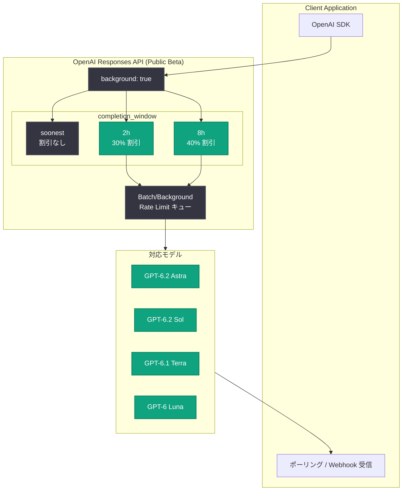

# Responses API バックグラウンド完了ウィンドウ (2 時間 / 8 時間) のパブリックベータ

## メタデータ

| 項目 | 内容 |
|------|------|
| 発表日 | 2026-11-17 |
| ソース | OpenAI API Changelog |
| カテゴリ | API 更新 |
| 公式リンク | https://developers.openai.com/api/docs/changelog |

## 概要

OpenAI は 2026 年 11 月 17 日、Responses API のパブリックベータとして、2 時間または 8 時間の「バックグラウンド完了ウィンドウ (background completion window)」を選択できる機能を発表した。即時の応答を必要としないワークロードに対して完了までの猶予時間を指定することで、モデルのトークン料金が標準 (Standard) よりも 2 時間ウィンドウで 30%、8 時間ウィンドウで 40% 割引される。

この機能は、バッチ的な大量処理や長時間のエージェント実行など、リアルタイム性よりもコスト効率を優先したいユースケースに向けたもので、GPT-6.2 Astra、GPT-6.2 Sol、GPT-6.1 Terra、GPT-6 Luna の各モデルで利用できる。

## 主な内容

### バックグラウンド完了ウィンドウとは

Responses API のバックグラウンドモード (`background: true`) では、リクエストを非同期に実行し、ポーリング、ストリーミング再開、または Webhook で結果を受け取ることができる。今回のアップデートでは、新たに `background_options.completion_window` パラメータで初回応答が必要な時期を指定できるようになった。

指定可能な値は次の 3 つ。

- `soonest` (デフォルト): 可能な限り早く処理。割引なし
- `2h`: 2 時間以内の完了を目標。トークン料金 30% 割引
- `8h`: 8 時間以内の完了を目標。トークン料金 40% 割引

完了目標は、API が初回リクエストを受理した時点から起算される。

### 料金割引の比較

| 完了ウィンドウ | 完了目標 | モデルトークン料金 | 割引率 (Standard 比) |
|----------------|----------|--------------------|----------------------|
| `soonest` (デフォルト) | 可能な限り早く | 標準料金 | 割引なし |
| `2h` | 受理から 2 時間以内 | 標準の 70% | 30% 割引 |
| `8h` | 受理から 8 時間以内 | 標準の 60% | 40% 割引 |

割引は対象リクエストごとのモデルトークン料金に適用され、`continuation_id` を用いたマルチステップ実行のフォローアップリクエストも割引対象となる。

### 対応モデルと前提条件

パブリックベータ時点で割引ウィンドウに対応するモデルは以下のとおり。

- GPT-6.2 Astra (`gpt-6.2-astra`)
- GPT-6.2 Sol (`gpt-6.2-sol`)
- GPT-6.1 Terra (`gpt-6.1-terra`)
- GPT-6 Luna (`gpt-6-luna`)

割引ウィンドウの利用には Standard 処理が必須で、`service_tier` は `default` (Standard) または `auto` を指定する。`auto` の場合は API が Standard を選択した場合のみ割引対象となる。

## 技術的な詳細

### 主要パラメータ

| パラメータ | 値 | 説明 |
|------------|----|------|
| `background` | `true` / `false` | 非同期実行を有効化 |
| `background_options.completion_window` | `soonest` / `2h` / `8h` | 初回応答が必要な時期を指定 |
| `background_options.continuation_id` | アプリ側で決める一意の ID | マルチステップ実行の継続用。再利用でキュー優先度が上がる |
| `service_tier` | `default` / `auto` | 割引ウィンドウは Standard 処理が必須 |
| `stream` | `true` / `false` | `2h` / `8h` では未設定か `false` にする |
| `previous_response_id` | 前回の応答 ID | 会話履歴の引き継ぎ (前応答が有効な場合のみ) |

### コードサンプル

2 時間の完了ウィンドウを指定してバックグラウンド実行し、ポーリングで結果を取得する例。

```python
from time import sleep

from openai import OpenAI

client = OpenAI()

# 2 時間ウィンドウ (30% 割引) でバックグラウンド実行を開始
resp = client.responses.create(
    model="gpt-6.2-astra",
    input="Write a very long novel about otters in space.",
    background=True,
    background_options={"completion_window": "2h"},
    service_tier="default",
)
print(resp.status)  # queued

# ステータスが queued / in_progress の間ポーリング
while resp.status in {"queued", "in_progress"}:
    sleep(2)
    resp = client.responses.retrieve(resp.id)

print(resp.status)
print(resp.output_text)
```

キャンセルは `client.responses.cancel(response_id)` で行い、冪等に動作する。結果の受信にはポーリングのほか、Webhook (`response.completed` などのイベント購読) も利用できる。

### 制約事項

- `2h` / `8h` のリクエストは Batch API と「Batch/Background Rate Limit」を共有する。入力トークンは送信時にカウントされる (`soonest` は通常のレート制限)
- ストリーミングは `soonest` のみ対応。`2h` / `8h` では `stream` を未設定か `false` にする
- `store: false` や Zero Data Retention の場合でも、バックグラウンドモードは実行と取得のために応答データを一時保存する (全ウィンドウで保存時に暗号化)
- 割引ウィンドウ外の Standard リクエストは、`2h` / `8h` リクエストが作成したプロンプトキャッシュを再利用できない
- `2h` / `8h` の受理後、対象となる容量エラーは API が自動リトライする
- バックグラウンド応答は、同期応答よりも最初のトークンまでの時間が長くなる場合がある

## アーキテクチャ



## 開発者への影響

- **コスト削減**: 即時性が不要なワークロード (大量のコンテンツ生成、ドキュメント処理、評価ジョブなど) を `8h` ウィンドウに回すだけで、モデルトークン料金を最大 40% 削減できる
- **エージェントワークフローとの親和性**: `continuation_id` によるマルチステップ実行のフォローアップも割引対象となるため、長時間のエージェント処理全体でコスト効率が向上する
- **設計上の考慮が必要**: ストリーミングが使えない、プロンプトキャッシュが Standard リクエストと分離される、Batch API とレート制限を共有するなど、既存の同期的な設計からの移行には制約の確認が必要
- **信頼性の向上**: 受理後の容量エラーは API が自動リトライするため、クライアント側のリトライ実装を簡素化できる

## 関連リンク

- [OpenAI API Changelog](https://developers.openai.com/api/docs/changelog)
- [バックグラウンドモードガイド (割引付き完了ウィンドウ)](https://developers.openai.com/api/docs/guides/background#use-discounted-completion-windows)
- [OpenAI API リファレンス](https://platform.openai.com/docs/api-reference)

## まとめ

Responses API のバックグラウンド完了ウィンドウは、「いつまでに応答が必要か」をコストと引き換えに選択できる新しい仕組みである。`2h` で 30%、`8h` で 40% のトークン料金割引はパブリックベータとして GPT-6.2 Astra / Sol、GPT-6.1 Terra、GPT-6 Luna で利用可能で、Batch API に近いコスト効率を Responses API の非同期実行モデル (ポーリング、Webhook、継続実行) のまま享受できる。即時性が不要なワークロードを持つ開発者は、`background_options.completion_window` の指定を検討する価値がある。
