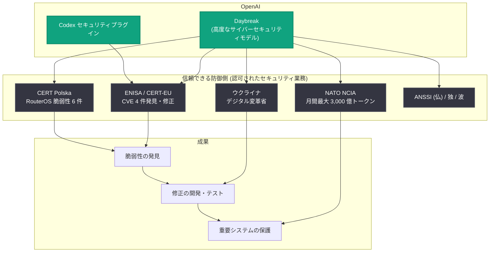

# AI による NATO および同盟国のサイバー防衛強化

## メタデータ

| 項目 | 内容 |
|------|------|
| 発表日 | 2026-11-17 |
| ソース | OpenAI News |
| カテゴリ | Global Affairs |
| 公式リンク | https://openai.com/index/strengthening-nato-allied-cyber-defences-ai |

## 概要

OpenAI は、NATO および同盟国のサイバー機関と協力し、信頼できる防御側 (trusted defenders) が脆弱性を発見し、修正をテストし、重要なシステムを保護することを支援する取り組みを発表した。この取り組みの中核となるのが「Daybreak」であり、政府機関や国家サイバー機関などの認可された防御組織に高度な AI を提供し、ソフトウェアのレビュー、不審な活動の調査、脆弱性の検証、修正の開発・テストといったセキュリティ業務を支援する。

NATO 通信情報機関 (NCIA) との協業では、NATO が月間最大 3,000 億の生入出力トークンを使用するという大規模な利用実績が示されたほか、ウクライナ、EU (ENISA)、ポーランド (CERT Polska)、フランス (ANSSI)、ドイツの各機関への提供と、具体的な脆弱性発見・修正の成果が報告されている。

## 主な内容

### Daybreak による信頼できる防御側への AI 提供

Daybreak は、信頼できる防御組織に高度な AI を提供するための OpenAI の仕組みである。対象となる業務は以下の通り、認可されたセキュリティ業務 (authorized security work) に限定されている。

- ソフトウェアのレビュー
- 不審な活動の調査
- 脆弱性の検証
- 修正の開発とテスト

アクセスは政府機関や国家サイバー機関などの信頼された防御組織に限定されており、NATO NCIA、ウクライナのデジタル変革省、EU の ENISA、フランスの ANSSI、ドイツおよびポーランドの国家サイバー機関などに提供されている。

### NATO との協力: NCIA と月間 3,000 億トークンの利用

NATO 通信情報機関 (NCIA) との協業により、NATO の中核機関が高度なサイバーセキュリティモデルへのアクセスを得て、同盟ネットワークの保護に活用している。NATO は月間最大 3,000 億の生入出力トークンを使用しており、多国籍チームのサイバー専門知識の強化や、欧州・同盟全体の防御側に役立つ知見の創出に貢献している。

NCIA ゼネラルマネージャーの Dylan Browne 博士は、AI サイバー防衛モデルを「サイバーセキュリティにおける世代的飛躍 (a generational leap in cyber security)」と評価し、脆弱性発見の加速、マシンスピードでの脅威検知、防御側の優位性維持を可能にすると述べた。また、導入拡大に伴いトークン消費・利用パターン・経済性の理解を深め、コスト最適化や調達判断に活かすとしている。

OpenAI の国家安全保障政策責任者 Sasha Baker 氏は、民主主義を守る人々に最先端技術を届けるべきであり、Daybreak により「攻撃者が悪用する前に脆弱性を発見し修正する」支援をしたいと表明した。

### 2026 年「Crossed Swords」演習での AI エージェント訓練

NATO サイバー防衛協力センター (CCDCOE) が主催する 2026 年の「Crossed Swords」演習を OpenAI が支援した。この演習には、参加者がサイバー作戦用の AI エージェントを構築・展開・評価する新たな訓練ストリームが含まれ、技術環境で Daybreak が使用された。参加者は AI エージェントとともにオペレーターとして活動し、人間による監督 (human oversight) の維持が重視された。

### 同盟国政府での具体的な成果

| 組織 | 取り組みと成果 |
|------|---------------|
| ウクライナ デジタル変革省 | 継続的なサイバー攻撃下で、Daybreak を用いて民間インフラのサイバー防衛を強化。脆弱性の特定と修正の開発・テストを迅速化 |
| ENISA (EU サイバーセキュリティ機関) | OpenAI モデルで EU 機関のソフトウェアに 4 件の脆弱性を発見し、全件の修正を公開 (CVE-2026-73432、CVE-2026-73431、CVE-2026-73405、CVE-2026-73374)。2026 年 11 月の ENISA・CERT-EU 共同報告では、Daybreak 経由のモデルや Codex セキュリティプラグインで 27 のソフトウェアプロジェクトを調査し、評価された 88 件の潜在的問題のうち 95% が保守者により本物と確認された |
| CERT Polska | MikroTik RouterOS の 6 件の脆弱性特定を支援し、ベンダーと協調開示。研究者が実システムでの検証を主導し、AI が分析を加速。MikroTik が修正を公開し、観測されていた攻撃の防止を確認 |
| フランス (ANSSI)、ドイツ、ポーランド | 各国の国家サイバー機関にアクセスを提供済み |

### 責任ある AI 導入と人間の監督

OpenAI は NATO の「責任ある AI 導入の原則」に全面的にコミットし、安全でセキュアなソリューションの提供を約束している。各事例に共通するのは、AI が人間の専門家を置き換えるのではなく分析を加速する役割に徹している点である。

- Crossed Swords 演習では人間による監督の維持が重視された
- CERT Polska の事例では、研究者が作業を主導し、実システムでの検証と影響確認を行った
- ENISA の事例では、ソフトウェア保守者 (人間) が潜在的問題を評価・確認するプロセスが組み込まれており、AI と人間の専門知識を組み合わせる価値が実証された

## アーキテクチャ

## 開発者・セキュリティ関係者への影響

- **AI 支援による脆弱性発見の実用化**: ENISA の事例では評価された潜在的問題の 95% が本物と確認されており、AI によるソフトウェアセキュリティレビューが実運用レベルの精度に達していることが示された
- **協調的脆弱性開示の加速**: CERT Polska と MikroTik の事例のように、AI が分析を加速することで、脆弱性の特定からベンダーによる修正公開までのサイクルが短縮される
- **人間の監督を前提とした運用モデル**: いずれの事例でも人間の専門家が検証・確認を主導しており、AI エージェントを防御業務に組み込む際の参考となる運用パターンが示された
- **アクセスの限定**: Daybreak は一般公開されておらず、政府機関や国家サイバー機関などの信頼された防御組織に限定して提供されている

## 関連リンク

- [Strengthening NATO and allied cyber defenses with AI (公式発表)](https://openai.com/index/strengthening-nato-allied-cyber-defences-ai)
- [OpenAI News](https://openai.com/news)
- [NATO CCDCOE (サイバー防衛協力センター)](https://ccdcoe.org/)
- [ENISA (EU サイバーセキュリティ機関)](https://www.enisa.europa.eu/)

## まとめ

OpenAI は Daybreak を通じて、NATO NCIA をはじめとする同盟国のサイバー機関に高度な AI を提供し、防御側の能力強化を進めている。NATO の月間最大 3,000 億トークンという利用規模、ENISA による CVE 4 件の発見・修正、CERT Polska による MikroTik RouterOS の脆弱性 6 件の協調開示など、具体的な成果が示された点が特徴である。全ての事例で人間による監督と検証が維持されており、OpenAI は NATO の責任ある AI 導入原則へのコミットメントを明言した上で、今後も各国政府・国際パートナーと協力し、攻撃者に悪用される前の脆弱性発見と迅速な修正を支援するとしている。
