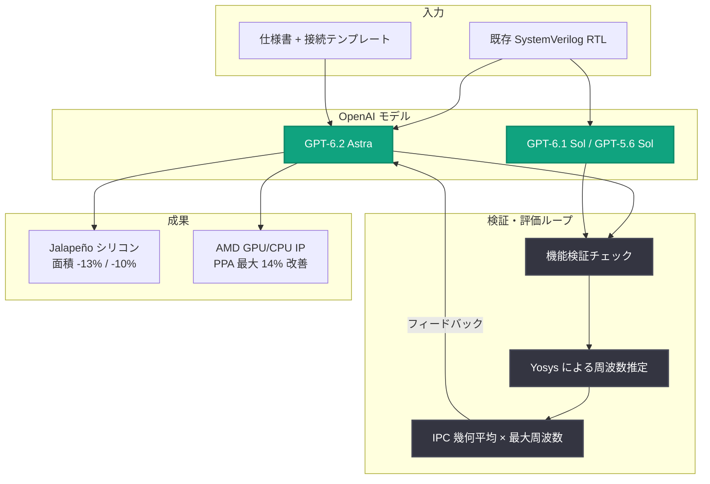

# OpenAI モデルによるチップ設計の進化 — Jalapeño シリコンと RISC-V コア最適化の成果

## メタデータ

| 項目 | 内容 |
|------|------|
| 発表日 | 2026-11-18 |
| ソース | OpenAI Research |
| カテゴリ | 研究成果 |
| 公式リンク | https://openai.com/index/advancing-chip-design-with-our-models |

## 概要

OpenAI は、自社モデルを半導体チップ設計に適用した成果を発表した。自社開発の推論用カスタムチップ「Jalapeño」の演算ブロック最適化、AMD との共同プロジェクトにおける GPU/CPU IP の PPA (Power, Performance, Area) 改善、そしてオープンソース RISC-V コアを題材とした体系的なベンチマーク評価という 3 つの柱で構成されている。

特に注目すべきは、モデルが SystemVerilog RTL を書き換えることで、人手で高度に最適化済みのベースラインに対して最大 14% の PPA 改善を達成した点と、最新モデル GPT-6.2 Astra が既存 RTL の最適化だけでなく、仕様書からのゼロベース設計でも高いスコアを記録した点である。さらに Synopsys との提携により、EDA ツールを専門家のように使いこなす新モデル「GPT-Synopsys」の訓練も進行中であり、AI 支援チップ設計が実シリコンで実証される段階に入ったことを示している。

## 主な内容

### Jalapeño 演算ブロックの最適化

OpenAI のカスタム推論チップ Jalapeño に対する取り組みは 2025 年初頭に開始され、当初は o3-mini を用いて「非自明な PPA 改善」が確認された。最適化はベクトルユニットと行列ユニットの両方で実シリコンに反映されている。

- **ベクトルユニット**: 浮動小数点加算器・乗算器、変換関数、リダクションロジック、特殊関数ユニットで面積を削減。モデルは代替ロジックの探索やパイプラインステージの分割方法の変更を提案した
- **行列ユニット**: ある乗算器の再設計では、合成時のセル面積を約 15% 削減しつつ、レイテンシを 2 クロックサイクルから 1 サイクルに短縮。別の加算器の再設計では 2 サイクルのレイテンシを維持したままセル面積を約 15% 削減した

最終的な標準セル面積の削減率は、ベクトルユニットで約 13%、行列ユニットで約 10% と推定され、これらの改善は Jalapeño のブリングアップ時にシリコン上で実証済みである。

### AMD とのコラボレーション

AMD のフラッグシップ GPU IP において、SystemVerilog RTL の書き換えにより、高度に最適化済みのベースラインと比較して最大 14% の PPA 改善を達成した。この成果は「約 1 年分の進歩を 5 か月未満で達成した」と表現されている。

- AMD は一部の変更を製造向け設計に採用し、その他の変更も量産設計ファイルに組み込んだ
- モデルは「熟練マイクロアーキテクトのレベル」で推論し、検証と PPA トレードオフ評価には Synopsys のツールを使用した
- AMD の次世代フラッグシップ CPU の主要ブロックでも、1 桁パーセントの PPA 改善が検証された

### RISC-V コアを用いた体系的評価

モデル能力を定量的に測定するため、オープンソースの 32 ビット RISC-V コア 2 種類を題材としたベンチマークを構築した。

| コア | 特徴 |
|------|------|
| PicoRV32 | FPGA 向けのコンパクトなコア |
| Ibex | OpenTitan で採用される組み込みプロセッサ |

タスクはスループット (1 秒あたりの命令実行数) の向上であり、合計 9,881 回のスコア付き実行が行われた。

### 仕様書からのゼロベース設計

既存 RTL の最適化に加え、文書化された要件と接続テンプレートのみを与え、データフローやパイプラインステージングをモデル自身に選択させる「仕様からの設計」タスクも評価された。

- 約 112,000 トークンの予算において、評価対象の 5 モデルすべてが、既存 RTL の最適化よりも仕様からの設計で高いスコアを記録した (両コア共通)
- GPT-6.2 Astra は PicoRV32 で平均 0.7、Ibex で約 0.75 のスコアを達成した

ただし、仕様ベースの設計はパフォーマンスカウンタや追加命令などの機能を省略する可能性があり、それがスコアの高さの一因である点に OpenAI 自身が言及している。より厳しい面積制限や物理合成後のタイミング検証を導入することで、評価の現実性が向上するとしている。

## 技術的な詳細

### 評価手法とスコアリング

RISC-V ベンチマークのスコアリングは以下のルールで行われた。

1. **失格条件**: 検証チェックに失敗した場合、または面積が元設計の 16 倍を超えた場合はスコア 0
2. **スコア算出**: 非公開ワークロードにおける IPC (Instructions Per Cycle) の幾何平均 × Yosys で推定した最大クロック周波数
3. **正規化**: 最良の結果を 1.0 に正規化し、平均値にはスコア 0 の実行も含める

### モデル間の性能比較

約 112,000 トークン/実行の予算における主な結果は以下のとおりである。

| 比較項目 | 結果 |
|----------|------|
| 最高平均スコア (両コア) | GPT-6.2 Astra |
| 世代間比較 | GPT-6.1 Sol が GPT-5.6 Sol を上回る |
| PicoRV32 での伸び | GPT-6.2 Astra のスコアは GPT-6 Astra の約 2 倍 |
| Ibex での傾向 | GPT-6.2 Astra はトークン予算を増やすほどスコアが伸び続ける。GPT-6 Astra と GPT-6.1 Sol は拮抗 |

### 主要な統計数値まとめ

| 項目 | 数値 |
|------|------|
| Jalapeño ベクトルユニットの標準セル面積削減 | 約 13% |
| Jalapeño 行列ユニットの標準セル面積削減 | 約 10% |
| 乗算器再設計のセル面積削減 | 約 15% (レイテンシ 2 → 1 サイクル) |
| AMD GPU IP の PPA 改善 | 最大 14% |
| AMD 次世代 CPU 主要ブロックの PPA 改善 | 1 桁パーセント |
| スコア付き実行の総数 | 9,881 回 |

## アーキテクチャ

AI 支援チップ設計のワークフローを以下に示す。

## 開発者への影響

- **ハードウェア設計者**: RTL 最適化や仕様からの設計において、AI モデルが熟練マイクロアーキテクトに匹敵する提案を行えることが実シリコンで実証された。設計サイクルの大幅な短縮 (1 年分の進歩を 5 か月未満で達成) が期待できる
- **EDA エコシステム**: Synopsys との提携による「GPT-Synopsys」の登場で、EDA ツールを AI が直接操作する設計フローが現実味を帯びる
- **RISC-V コミュニティ**: PicoRV32 や Ibex といったオープンソースコアが AI 設計能力のベンチマークとして採用されており、オープンな評価基盤の重要性が増している
- **AI 研究者**: トークン予算の増加に伴いスコアが伸び続ける傾向が示されており、推論時スケーリングがハードウェア設計タスクでも有効であることを示唆している

## 関連リンク

- [Advancing chip design with OpenAI models (元記事)](https://openai.com/index/advancing-chip-design-with-our-models)
- [OpenAI Research](https://openai.com/research)
- [OpenAI News](https://openai.com/news)
- [PicoRV32 (GitHub)](https://github.com/YosysHQ/picorv32)
- [Ibex (lowRISC)](https://github.com/lowRISC/ibex)
- [Yosys Open SYnthesis Suite](https://yosyshq.net/yosys/)

## まとめ

OpenAI は、自社モデルがチップ設計の最前線で実用的な成果を上げていることを、実シリコン (Jalapeño)、産業パートナーシップ (AMD)、体系的ベンチマーク (RISC-V コア) の 3 つの証拠で示した。Jalapeño ではベクトルユニットで約 13%、行列ユニットで約 10% の面積削減を達成し、AMD の GPU IP では最大 14% の PPA 改善を量産設計に反映した。GPT-6.2 Astra は既存 RTL の最適化と仕様からのゼロベース設計の両方で先行モデルを上回り、特に後者では全モデルが最適化タスクを超えるスコアを記録した。今後は Synopsys と共同で EDA ツールを使いこなす専用モデル「GPT-Synopsys」を訓練し、GPU・CPU 設計でのさらなる PPA 改善を目指すとしており、AI 支援チップ設計は研究段階から産業実装へと移行しつつある。
