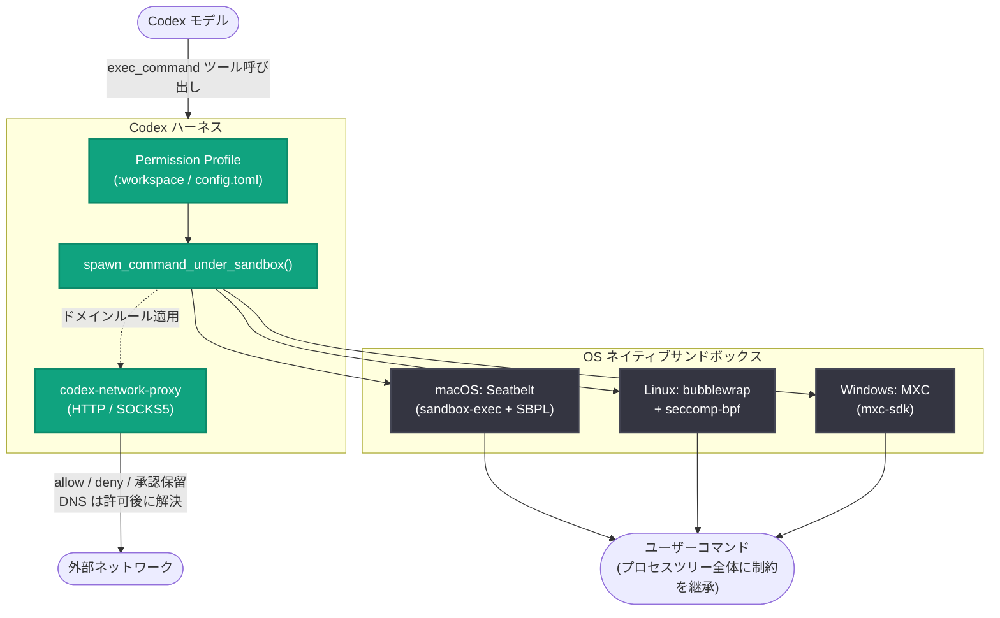

# Codex サンドボックスの内部構造: OS ネイティブ機構によるファイルシステム・ネットワーク制限の実装

## メタデータ

| 項目 | 内容 |
|------|------|
| 発表日 | 2026-11-18 |
| ソース | OpenAI News (Engineering) |
| カテゴリ | 技術解説 |
| 公式リンク | https://openai.com/index/inside-the-codex-sandbox |

## 概要

OpenAI は、コーディングエージェント Codex がユーザーのマシン上でコマンドを実行する際に、ユーザーが制御するファイルシステム・ネットワーク制限をどのように強制しているかを解説する技術記事を公開した。Codex は VM やコンテナではなく、macOS の Seatbelt、Linux の bubblewrap + seccomp-bpf、Windows の MXC (Microsoft eXecution Container) という各 OS ネイティブのサンドボックス機構を採用している。これは、開発者のラップトップが iOS ビルドツールチェーンや iPhone シミュレータなどホスト依存ツールを含む独自環境であり、Docker などのコンテナ内では再現できないためである。

記事では、モデルの訓練・アラインメントに加えてエージェントハーネス側でも保護を実装する「多層防御 (defense in depth)」の思想のもと、permission profile (`:workspace` など) の仕組み、`config.toml` の `[permissions]` によるカスタムプロファイル定義、`codex-network-proxy` によるドメインルールの適用と DNS 漏洩対策、そして 3 つの OS それぞれの実装詳細が解説されている。

## 主な内容

### 設計思想: OS ネイティブサンドボックスによる多層防御

サンドボックスは実行中のプログラムのアクセスを制限する仕組みである。たとえば写真整理タスクでは `~/Pictures` の読み書きのみを許可してネットワークを遮断し、コードレビューではオンラインドキュメントへのアクセスを許可しつつソースを読み取り専用にする、といった使い分けができる。

Codex は各 OS のネイティブなサンドボックス機構を使い、ユーザーの既存環境内でコマンドを制約する。3 つの OS すべてで共通のサンドボックス API を通じてコマンドを起動し、プラットフォーム固有の実装が制約を適用する構成となっている。

### `:workspace` プロファイルのデフォルト動作

Codex 標準の `:workspace` プロファイルは以下の 3 点を柱とする。

1. **ワークスペース内の書き込みを許可**: ただし `.git` や `.codex` は読み取り専用とし、`.codex/config.toml` や `.git/hooks` の直接改変を防止する
2. **広範なファイルシステム読み取りを許可**: コンパイラやビルドツールがリポジトリ外の SDK やライブラリに依存するため (OS 権限の範囲内)。トレードオフとして API キーを含む設定ファイルなども読める可能性がある
3. **ネットワークアクセスを無効化**: データ流出や外部アップロードを防止する。依存関係のダウンロードなど正当な操作にも追加許可が必要になる

残存リスクの例として、`node_modules/prettier` のようなローカルパッケージへの悪意あるコード注入が挙げられている。`node_modules` は Git に無視されることが多く `git status` に現れないため、エディタの保存時フォーマッタ経由でサンドボックス外で実行され得る。

### サンドボックス API と exec_command ツール

ハーネスは共通 API `spawn_command_under_sandbox()` を通じてコマンドと permission profile を受け取り、限定的なネットワーク許可時にはプロキシも渡す。子プロセスは親の制約を継承し、元プロセスより長生きする子孫を含むプロセスツリー全体に制約が適用される。

```python
# This is a simplified version of the actual API.
def spawn_command_under_sandbox(
    program_and_args: list[str],
    cwd: Path,
    env: dict[str, str],
    permission_profile: PermissionProfile,
    network_proxy: NetworkProxy | None,
) -> Child:
```

モデルが呼び出す `exec_command` ツールはコマンド単位で権限変更を要求できる。

```python
class ExecCommandToolCall:
    # ...command-related fields...

    # Per-command sandbox override. Defaults to "use_default".
    sandbox_permissions: Literal[
        "use_default",
        "with_additional_permissions",
        "require_escalated",
    ] = "use_default"

    # User-facing approval question; only for "require_escalated".
    justification: str | None = None

    # Expand network or filesystem access; only for "with_additional_permissions".
    additional_permissions: AdditionalPermissions | None = None
```

- `use_default`: ターンのデフォルト設定を使用
- `with_additional_permissions`: サンドボックス内での拡張アクセスを要求
- `require_escalated`: サンドボックス外での実行を要求

エスカレーション要求はハーネスがユーザー設定に基づき判断し、ユーザーへの直接プロンプト、または auto-review へのルーティングで処理される。

### Permission Profile のカスタマイズ (config.toml)

`config.toml` の `[permissions]` で独自プロファイルを定義できる。ファイルシステムエントリは `read` / `write` / `deny` の 3 種類で、`:workspace_roots` テーブルによりワークスペースルート相対のルールを定義できる (CLI は作業ディレクトリを唯一のルートとし、ChatGPT デスクトップアプリはプロジェクトのソースフォルダを使用する)。

```toml
# Use the dev profile by default.
default_permissions = "dev"

[permissions.dev]
# This is displayed when /permissions is run in the Codex CLI.
description = "Development with extra read-only protections."

# A profile can be derived from an existing profile.
# Profiles starting with ":" are provided by Codex.
extends = ":workspace"

[permissions.dev.filesystem]
"~/build-cache" = "write"

[permissions.dev.filesystem.":workspace_roots"]
".devcontainer" = "read"
".vscode" = "read"
"**/*.env" = "deny"
"secrets" = "deny"
```

参考として、組み込みの `:workspace` プロファイルは以下の保護を持つ。

```toml
[permissions.":workspace".filesystem.":workspace_roots"]
".agents" = "read"
".aws" = "read"
".codex" = "read"
".git" = "read"
```

複数の `config.toml` は階層的にマージされる。テーブルは再帰的にマージされ高優先度が勝ち、配列は全体が置換される — これがプロファイル定義にテーブルを使う理由である。管理者は `requirements.toml` で利用可能なプロファイルを制約でき、クラウド配布の要件は `/etc/codex/requirements.toml` に優先する。`":danger-full-access" = false` のような明示的な禁止指定は上書きできない。

```toml
default_permissions = ":read-only"

[allowed_permission_profiles]
":read-only" = true
":danger-full-access" = false
```

### ネットワーク設定とドメインルール

ネットワークには 3 つのオプションがある。

1. 全ネットワーク無効 (`:workspace` のデフォルト)
2. 完全な直接アクセス (`:danger-full-access` のデフォルト)
3. プロキシ経由に制限 (プロファイルのドメインルールで判定)

```toml
[permissions.dev.network]
enabled = true

[permissions.dev.network.domains]
"*.openai.com" = "allow"
# Allow requests to local services by hostname or by IPv4/IPv6 loopback address.
"localhost" = "allow"
"127.0.0.1" = "allow"
"::1" = "allow"
"evil.example" = "deny"

[features]
# If neither local config nor managed requirements enable the proxy,
# this profile allows direct network access; domain rules are not enforced.
network_proxy = true
```

ドメインルールは完全一致とワイルドカードをサポートし、明示的な deny が allow に優先する。

### codex-network-proxy と DNS 漏洩対策

ネットワークプロキシは crate としてハーネスが利用し、スタンドアロン CLI としてもビルドできる。主な特徴は以下のとおり。

- デフォルトで HTTP プロキシと SOCKS5 プロキシを起動する
- `HTTP_PROXY`、`HTTPS_PROXY`、`ALL_PROXY` に加え、`PIP_PROXY` などアプリケーション固有の環境変数も注入する
- 環境変数を無視するプログラムの直接接続は OS のサンドボックスが遮断する
- allow / deny に一致しないドメインへのリクエストは保留し、ハーネスへ承認を委任する (ユーザープロンプトまたは auto-review)
- **DNS 漏洩対策**: ホスト名にエンコードされた情報が DNS ルックアップで漏れることを防ぐため、プロキシは許可または承認後にのみホスト名を解決する。ただし広範なワイルドカードや DNS サービスへのアクセスを許可すると、DNS ベースの情報流出が可能になる点に注意が必要

### codex sandbox コマンドと MCP サーバーのサンドボックス化

`codex sandbox` コマンドは任意のコマンドをプロファイルの下で実行でき、プロファイルのテストに利用できる。デフォルトで `cwd` をワークスペースルートとして扱う。

```console
$ codex sandbox --permission-profile dev -- \
    bash -c 'cat > .vscode/settings.json'
bash: .vscode/settings.json: Operation not permitted
```

応用例として、stdio MCP サーバーのサンドボックス化が紹介されている。ハーネスは MCP サーバーの起動コマンドをデフォルトではサンドボックス化しない (必要なファイルやネットワークを推測できないため) が、`codex sandbox` でラップすることで制約下で実行できる。

```toml
[permissions.memory-mcp.filesystem]
# Allow broad reads for Node.js/npm dependencies and configuration.
":root" = "read"
"~/.npm" = "write"
"~/mcp-data" = "write"

[permissions.memory-mcp.network]
enabled = false

[mcp_servers.memory]
command = "codex"
args = [
  "sandbox",
  "--permission-profile",
  "memory-mcp",
  "--",
  "npx",
  "--offline",
  "@modelcontextprotocol/server-memory@1.0.0"
]

[mcp_servers.memory.env]
MEMORY_FILE_PATH = "~/mcp-data/memory.jsonl"
```

事前に npm キャッシュへパッケージを投入しておくことで、`npx --offline` によりネットワーク無効のまま起動できる。

```bash
# The sandbox can write to this folder, but it cannot create it.
mkdir -p ~/mcp-data

# Installing the MCP server requires network access.
npx -y --package=@modelcontextprotocol/server-memory@1.0.0 -c true
```

## 技術的な詳細

### macOS 実装: Seatbelt

macOS では Apple のカーネル強制サンドボックス機構 Seatbelt を `/usr/bin/sandbox-exec` 経由で使用する。

```
sandbox-exec -p PROFILE [-Dkey=value]* -- PROG ARGS...
```

ポリシーは Scheme ベースの SBPL (Sandbox Profile Language) で記述する。たとえば `/dev/null` と `/dev/zero` を読み書き可能にするには次のように書く。

```scheme
(allow file-read* file-test-existence file-write-data
  (literal "/dev/null")
  (literal "/dev/zero"))
```

ベースプロファイルは `(deny default)` で開始し、明示的に許可した以外のアウトバウンド接続を遮断する。プロキシ有効時はローカルポートへの接続許可ルールを注入する。

```scheme
; local HTTP proxy launched by Codex
(allow network-outbound (remote ip "localhost:3128"))

; local SOCKS proxy launched by Codex
(allow network-outbound (remote ip "localhost:8081"))
```

SBPL は `(param)` プレースホルダを持ち、`-Dkey=value` オプションで値を埋め込める。

```scheme
; Pass -DWRITABLE_ROOT_0=/path/to/dir to specify a folder that cannot be removed.
(deny file-write-unlink
  (require-all
    (literal (param "WRITABLE_ROOT_0"))
    (vnode-type DIRECTORY)))
```

Apple は SBPL を非公開とし `man sandbox-exec` には DEPRECATED 表記があるが、macOS は `/usr/share/sandbox` にプロファイルを同梱し続けており、Chrome / Chromium も依存しているため、Codex は当面 Seatbelt を継続使用する方針である。

### Linux 実装: bubblewrap + seccomp-bpf

Linux では `codex-linux-sandbox` ヘルパーが `bwrap` (bubblewrap) でマウント名前空間内のファイルシステムビューを構築し、その中で seccomp-bpf を適用してからユーザーコマンドを実行する。

```
bwrap BWRAP_ARGS... -- \
  codex-linux-sandbox --apply-seccomp-then-exec CODEX_LINUX_SANDBOX_ARGS... -- \
  PROG ARGS...
```

- `bwrap` は自前のベンダー版を同梱するが、PATH 上の互換インストールを優先する (一部ディストリビューションはユーザー名前空間を無効化しつつシステム bwrap に例外を与えるため)
- `--bind` (書き込み可) / `--ro-bind` (読み取り専用) でパスを公開し、`--perms 000 --tmpfs DIR --remount-ro DIR` でディレクトリを、`--perms 000 --ro-bind-data FD FILE` でファイルを拒否する
- `--unshare-ipc`、`--unshare-pid` で他リソースも隔離し、ネットワーク無効時またはプロキシ使用時は `--unshare-net` で新しいネットワーク名前空間を作成する
- deny グロブは起動前に具体パスへ展開される (実行中に新たに一致するパスは追加されない)
- seccompiler crate で BPF プログラムを動的コンパイルし、ランチャープロセスに適用してプロセスツリー全体に継承させる。非特権での seccomp 適用のため `no_new_privs` フラグを設定し、setuid 実行による権限昇格も防止する
- ネットワーク無効時は `connect(2)`、`bind(2)` などを遮断し、プロキシ有効時は IP ソケットを許可しつつスタンドアロン Unix ドメインソケットの作成をデフォルトで遮断する

プロキシ接続では、bwrap 起動前に Unix ソケットペア (制御チャネル) を作成して fork し、サンドボックス内で作成したループバック TCP リスナーの FD をソケット経由でホスト側プロセスへ引き渡す。ホスト側プロセスがそのリスナーで接続を受け付け、ホストのネットワーク名前空間でプロキシへ中継する。macOS では Seatbelt がホストのループバック特定ポートへの直接接続を許可するのに対し、Linux では FD ハンドオフによりホストのネットワーク名前空間を晒さずに接続を実現している。

### Windows 実装: MXC

Windows では、従来の自前サンドボックスから Microsoft の **MXC (Microsoft eXecution Container)** ベースの実装へ移行中である。旧実装には管理者権限が必要、ACL 操作が高コスト、ホストに永続状態 (ACL、ファイアウォールルール、サンドボックスユーザーなど) が残るといった課題があった。

MXC は JSON 設定スキーマを公開しており、Codex は MXC SDK (mxc-sdk crate) でコマンド・作業ディレクトリ・環境・権限を含む実行リクエストを構築する。

```json
{
  "filesystem": {
    "readwritePaths": [
      "C:\\work\\demo",
      "D:\\Users\\dev\\build-cache"
    ],
    "readonlyPaths": [
      "C:\\",
      "D:\\",
      "Z:\\",
      "C:\\work\\demo\\.agents",
      "C:\\work\\demo\\.aws",
      "C:\\work\\demo\\.codex",
      "C:\\work\\demo\\.devcontainer",
      "C:\\work\\demo\\.git",
      "C:\\work\\demo\\.vscode"
    ],
    "deniedPaths": [
      "C:\\work\\demo\\config\\dev.env",
      "C:\\work\\demo\\config\\prod.env",
      "C:\\work\\demo\\secrets"
    ]
  },
  "network": {
    "egress": {
      "default": "deny",
      "allow": [{
        "to": [
          {"cidr": "127.0.0.0/8"},
          {"cidr": "::1/128"}
        ]
      }]
    },
    "ingress": {
      "default": "deny",
      "hostLoopback": "allow"
    }
  }
}
```

主なポイントは以下のとおり。

- **固定設定**: レジストリ読み取りと PowerShell 起動に必要な Win32k / デスクトップアクセスを保持しつつ、クリップボード、入力注入、デスクトップ / システム設定の制御は無効化。ホストのファイルシステム権限改変へのフォールバックも禁止
- **ドライブルート**: MXC はデフォルト拒否のため、広範な読み取りを実現するためにローカルドライブルートへ読み取り専用グラントを再帰的に追加する
- **競合解決**: より具体的なパスが祖先のグラントを上書きする (読み取り専用の `C:\` 配下で `C:\work\demo` を書き込み可能に、`.git` は読み取り専用のまま)。エイリアス / シンボリックリンク / ジャンクションが同一パスを指す場合は厳しい方が優先される (deny > read-only > read-write)
- **ネットワーク**: MXC は直接の外部接続を遮断しつつホストループバック接続 (プロキシを含む) を許可し、ドメインルールは共有プロキシが外部で強制する

## アーキテクチャ



## 開発者への影響

- **サンドボックス挙動の透明性向上**: Codex がローカル環境で何を許可し何を遮断しているかが明確になり、エージェントにタスクを委任する際のリスク評価がしやすくなる
- **カスタムプロファイルによる細かな制御**: `config.toml` の `[permissions]` で `:workspace` を拡張し、`.env` ファイルの deny やビルドキャッシュへの write 追加など、プロジェクトに合わせた権限設計ができる
- **ドメイン単位のネットワーク制御**: `network_proxy` とドメインルールにより、全面許可 / 全面禁止の二択ではなく、必要なドメインのみ許可する運用が可能になる
- **MCP サーバーの保護**: `codex sandbox` で MCP サーバーをラップすることで、デフォルトでは制約されない stdio MCP サーバーにもファイルシステム・ネットワーク制限を適用できる
- **組織ポリシーの強制**: 管理者は `requirements.toml` と `allowed_permission_profiles` で `:danger-full-access` の禁止など、上書き不可能なガードレールを配布できる
- **残存リスクの認識**: 広範な読み取り許可による秘密情報の読み取り、`node_modules` 経由のサンドボックス外コード実行、広いワイルドカード許可時の DNS ベース流出など、サンドボックスでも防げないリスクを理解した上で運用する必要がある

## 関連リンク

- [Inside the Codex sandbox (元記事)](https://openai.com/index/inside-the-codex-sandbox)
- [Codex ドキュメント](https://developers.openai.com/codex)
- [OpenAI News](https://openai.com/news)

## まとめ

本記事は、Codex のサンドボックスが VM やコンテナではなく OS ネイティブ機構 (macOS の Seatbelt、Linux の bubblewrap + seccomp-bpf、Windows の MXC) の上に構築されていることを示す詳細な技術解説である。3 つの OS で共通のサンドボックス API と permission profile を通じて、ワークスペース書き込み許可・広範な読み取り・ネットワーク遮断というデフォルトを強制しつつ、`config.toml` によるカスタマイズ、`codex-network-proxy` によるドメイン単位の制御と DNS 漏洩対策、管理者向けの `requirements.toml` まで多層的な制御を提供している。OpenAI は今後、権限設定の簡易化と OS 保護機構の活用拡大により、ユーザーの制御を保ったままエージェントの能力を広げることを目標としている。
