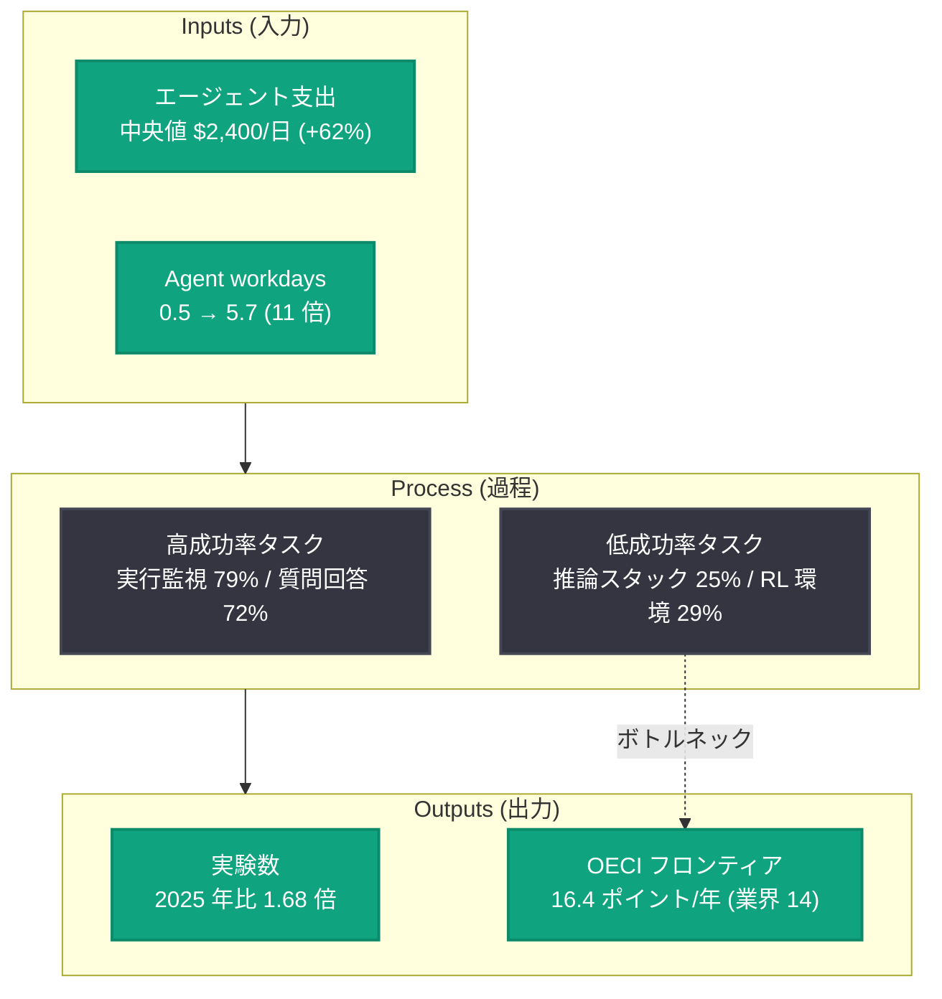

# Research acceleration: The jagged frontier — コーディングエージェントによる AI 研究加速の内部測定

## メタデータ

| 項目 | 内容 |
|------|------|
| 発表日 | 2026-11-18 |
| ソース | OpenAI Research |
| カテゴリ | 研究成果 |
| 公式リンク | https://openai.com/index/research-acceleration-jagged-frontier |

## 概要

OpenAI は、コーディングエージェントが社内の AI 研究開発サイクルをどの程度加速させているかを定量的に測定した研究報告を公開した。本報告は 2026 年 9 月の前回報告の続編であり、再帰的自己改善 (RSI: Recursive Self-Improvement) の指標を追跡・公開報告すべきとする同社のフロンティア政策の実践として位置づけられている。なお、本報告は「完全な RSI を追求する意図」を示すものではないと明言されている。

測定の結果、エージェント利用量は指数的に増加 (研究者 1 人あたりの agent workdays が 0.5 から 5.7 へ 11 倍増) し、OpenAI モデルの能力フロンティアは年間 16.4 ポイント (業界トレンドは 14 ポイント) で上昇している一方、タスクカテゴリ間の性能は不均一 (jagged) であり、低性能領域が全体的なアップリフトのボトルネックになり得ることが示された。

## 主な内容

### 測定手法

報告は Inputs (入力)、Process (過程)、Outputs (出力) の 3 部構成で、以下の手法を用いて測定された。

- **エージェント利用量の算出**: API 定価換算で支出額を計算
- **Agent workday の定義**: エージェント稼働 8 時間を 1 労働日と定義
- **時間配分の分析**: 2026 年 1 月〜9 月の Slack 投稿・PR・内部文書を分類器で研究領域に分類
- **タスク分類**: Epoch AI の「O*NET AI R&D taxonomy」を使用
- **調査・インタビュー**: 2026 年 8 月末〜9 月初旬に研究スタッフ 101 名を調査、10 名にインタビュー

### Inputs: エージェント利用量の指数的増加

- **エージェント支出 (API 定価換算、1 日あたり)**: 中央値 約 $2,400 (9 月の $1,500 から +62%)、90 パーセンタイルは約 $23,000 (同 $11,000 から +105%)
- **Agent workdays**: 研究者 1 人あたり 0.5 から 5.7 へ **11 倍増**。事前学習・事後学習チームでは約 8、スケーリング / インフラチームでは約 4
- **同時実行エージェント数**: 10 月中旬時点で研究者の 3 分の 2 超が日次ピーク 4 以上、10% 超が 16 以上
- **報酬との比較**: 2026 年 9 月時点で、エージェント利用の API 換算額は研究組織の非株式報酬の約 2 倍 (ただし株式は目標報酬の 70〜80% を占めるため除外されている)
- **計算資源**: 内部デプロイは研究計算資源全体のわずか 2%
- **Safety & Alignment 領域**: 全領域中最大の絶対増加 (年初からほぼ倍増)。2026 年 7 月の Hugging Face インシデント後に変曲点が観測された

### Process: タスク委任の成功率は不均一

2026 年 8 月 1 日〜10 月 18 日における「介入なし成功率」はカテゴリ・タスクごとに大きな差がある。

| 分類 | 成功率 |
|------|--------|
| Communicate (カテゴリ) | 69% |
| Analyze (カテゴリ) | 58% |
| Build (カテゴリ) | 43% |
| 実行監視 (タスク) | 79% |
| 技術的質問への回答 (タスク) | 72% |
| 評価 / RL / エージェント環境構築 (タスク) | 29% |
| 推論・サービングスタックのコード作成 (タスク) | 25% |

研究者調査 (101 名) では、以下の結果が得られた。

- 「GPT-5.2 より優れたコーディングエージェントへのアクセスが 3 か月失われたら」という仮想質問に対し、中央値で**チーム人員の 40%**、**現在の計算資源の 30%** (2027 年 1 月想定では 50%) を交換してもよいと回答
- コーディングエージェントなしでは、直近 1 か月分の仕事に中央値で 3 か月必要と回答
- 別調査 (10 月下旬、28 名) では、27 名が「中堅人間エンジニア + 2024 年モデル (o1-preview 等)」よりも最新内部モデルを選好

アイデア創出については、GPT-6 Astra の開発では重要アイデアはすべて人間由来だったが、GPT-6.2 Astra では事前学習研究者が Codex との対話でアイデアを発展させた例があり、「主要な洞察を特定した」との評価も報告されている。

### Outputs: 実験数と能力トレンドの加速

- **変更コード行数 / アクティブ貢献者**: 2026 年に急増 (28 日移動平均、テスト除外に手法を変更)
- **実験数**: 10 月 18 日までの 4 週間で、実験者あたり 2025 年ベースラインの **1.68 倍**
- **OpenAI ECI (OECI)**: Epoch Capabilities Index の内部版。公開 20 モデル + 他社 28 モデルを測定した結果、2025 年 8 月以降の OpenAI モデルのフロンティアは**年間 16.4 ポイント**上昇 (Epoch が観測する業界トレンドは 2024 年末以降で年間 14 ポイント)。トレンドラインは記録更新した 9 リリースに適合

### Jagged Frontier: 不均一な性能領域

モデルの性能はタスクカテゴリ間で均一ではない。Communicate 69% に対し Build 43%、実行監視 79% に対し推論スタックのコード作成 25% と、領域間の差は大きい。報告は、性能が不均一である限り、低性能のカテゴリやタスクが全体的なアップリフトのボトルネックになり得ると指摘している。

インタビューでも「エージェントは研究アイデア・コード品質・データ品質・文章の『センス』が悪い」「密接な人間の関与が必要」との声が示された。

### 再帰的自己改善 (RSI) への示唆

- エージェント利用の指数的増加、タスク委任の拡大、OECI の加速 (16.4 対 14 ポイント/年) は、RSI の初期指標として監視対象とされている
- 「研究のセンス」(アイデアの創出・検証能力) が RSI のボトルネックになり得るが、GPT-6.2 Astra では一部のアイデア創出に AI が寄与し始めた兆候がある
- 透明性のある報告が、能力・リスク・必要な安全策に関する公共の議論に不可欠だと主張している

## 開発者への影響

- **エージェント活用の実証データ**: 研究組織レベルでのエージェント投資対効果 (人員 40% / 計算資源 30% と等価と評価) が定量的に示され、開発チームへのエージェント導入判断の参考になる
- **委任戦略の指針**: 監視・質問応答などの高成功率タスクから委任を始め、低レベルシステムコードや RL 環境構築などの低成功率タスクでは密接な人間の関与を維持する、という実践的な指針が得られる
- **並列実行の常態化**: 研究者の 3 分の 2 超が日次ピークで 4 エージェント以上を同時実行しており、複数エージェントのオーケストレーションを前提としたワークフロー設計が重要になる
- **安全性監視の枠組み**: RSI の先行指標を公開報告する枠組みは、AI 開発組織における安全ガバナンスの参照モデルとなる

## 関連リンク

- [Research acceleration: The jagged frontier (元記事)](https://openai.com/index/research-acceleration-jagged-frontier)
- [OpenAI Research](https://openai.com/research)
- [OpenAI News](https://openai.com/news)
- [Epoch AI (Epoch Capabilities Index)](https://epoch.ai/)

## まとめ

OpenAI の内部測定により、研究者はコーディングエージェントをより集中的に利用し (agent workdays 11 倍増)、より多くの仕事を委任し、モデルの能力と限界に合わせてワークフローを適応させていることが示された。能力フロンティアは年間 16.4 ポイントと業界トレンド (14 ポイント) を上回るペースで上昇している。ただしアップリフトは不均一 (jagged) であり、推論スタックのコード作成 (25%) や RL 環境構築 (29%) など低成功率の領域がボトルネックとして残る。報告は、過去のトレンドが将来の AI 駆動の進歩を予測しない可能性にも言及し、今後は (1) 能力研究と安全研究の差分加速、(2) 研究加速の先行指標、(3) 全体的能力トレンドへの AI 加速の影響、へと報告を拡張する予定である。
