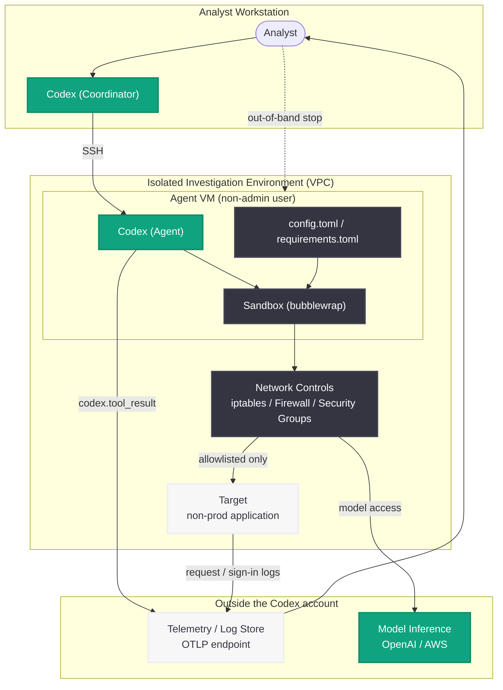

# Daybreak Red のデプロイ: 監督付きセキュリティ調査のためのリファレンスアーキテクチャ

## メタデータ

| 項目 | 内容 |
|------|------|
| 発表日 | 2026-11-19 |
| ソース | OpenAI News |
| カテゴリ | Guides |
| 公式リンク | https://openai.com/business/learn/deploying-daybreak-red |

## 概要

OpenAI は、サイバーセキュリティ調査向けモデル「Daybreak Red」を安全にデプロイするためのリファレンスアーキテクチャガイドを公開した。Daybreak Red は強力なサイバーセキュリティ調査ツールであり、本ガイドは監督付きセキュリティ調査 (supervised security investigations) のための隔離環境を、アーキテクチャ、安全制御、環境構築、調査の実行と監視という観点から解説している。

ガイドが強調するのは、構成そのものよりも「制御を理解すること」である。リファレンスアーキテクチャは出発点に過ぎず、最も重要な成果は各制御の意図を把握し、自組織の環境で OpenAI のサイバーモデルを安全に実装できるようになることだと明記されている。目的は、モデルにタスク遂行に必要な水準のアクセスを与えつつ、その活動に対する可視性 (visibility) とガバナンスを維持することにある。

## 主な内容

### アーキテクチャの全体像

アナリストは自身のワークステーション上の Codex から調査を指揮し、結果をレビューする。実際のコマンドは分離された Agent VM 上で実行され、ラボのネットワークルールが VM の到達範囲を制限する。さらに、Codex が何を行ったか、どのリクエストがテスト対象アプリに届いたかを、独立したログストアが記録する。

ガイドが定義する構成要素は次のとおり。

| コンポーネント | 役割 |
|----------------|------|
| Analyst | 調査を監督する権限を持つ個人。調査の開始、テストのスコープ設定、調査の停止、結果の分析に責任を持つ |
| Isolated investigation environment | 環境の論理的分離。本リファレンスでは隔離された VPC 上のホスト型 VM を想定。具体像は各組織のインフラに依存する |
| Coordinator | アナリストのマシンにローカルインストールされた Codex。リモートホストへの接続を管理し、結果を提示し、実行を監督する。Agent VM 上の Codex にはこのインスタンス経由で接続する |
| Agent VM | 隔離環境内で非管理者ユーザーとして Codex を実行し、分析を実行する。本ガイドは使い捨て (disposable) の VM を前提とする |
| Model inference | モデル配信のための OpenAI への接続性。OpenAI モデルは AWS 経由でも利用可能 |
| Network controls | リソースアクセスを制御する論理的なポイント。Agent VM 上の iptables、ファイアウォール、またはインフラ側のセキュリティグループで実現できる |
| Target | 調査を実施する対象となる非本番 (non-prod) アプリケーション |
| Telemetry | Target と Agent VM の外部にあるデータストア。何がいつ起きたかを立証するログを永続化する |

コンテナを使う場合は、調査に対して VM と同等のファイルおよびネットワーク制限を強制できることを検証するよう求めている。

### 安全制御 (Safety controls)

サイバーモデルのデプロイには複数層の安全制御が必要であり、本設計は OpenAI が推奨するサイバー業務向け構成に従っている。

**スコープ定義**: 調査スコープはテスト実行のパラメータを定める。対象 (target)、許可されるアクション、調査ウィンドウ、停止ポイントを定義する。必要な証拠は何か、Codex が対象アプリへ匿名でアクセスするのか専用アカウントを使うのかを事前に決める。サインインする場合は、そのアカウントを調査に必要なロールとリソースに限定する。

**VM システム制御**: Codex は専用の非管理者アカウントで実行する。Codex のサンドボックスが VM 上で読み書きできるコマンド範囲を制限する。スクリプトや結果を保存する必要がある場合は書き込み可能なワークスペースを与える。読み取り専用ワークスペースでも、承認済みのネットワークリクエストは許可できる。秘密鍵、デプロイ用クレデンシャル、ホスト管理ソケットは当該アカウントの手の届かない場所に置く。

**ネットワークアクセス制御**: Codex のネットワークプロキシにより、サンドボックス内コマンドの接続先を絞り込める。たとえば VM 自体は 3 つのステージングアプリに到達できても、Codex の許可リスト (allowlist) はスコープ内の 1 つだけを許可するという構成が可能である。Codex の許可リストに加えて、調査環境の外部へのアクセスを制限するネットワーク制御も実装すべきとしている。ベストプラクティスとして、ネットワーク接続は必要な宛先のみに限定する。ブラウザ、コネクタ、MCP ツールを有効化する場合は、それぞれのネットワークアクセスを個別に確認する。

**機密アクションのレビュー**: アクションが承認を要し、かつ Auto-review の対象である場合、別のレビュアーが続行可否を判断する。アナリストは調査のスコープを設定し、実行を監督する。Codex が新しい対象やアカウントを使う必要が生じた場合、あるいは合意済みスコープ外のアクションを取ろうとする場合は、実行を一時停止し、アナリストが権限を確認してから続行する。

**テレメトリと制御**: Codex のツール活動、対象のリクエストログ、アプリケーションのサインインイベントを、Codex アカウントの管理外にあるログストアに保持する。

### 環境構築 (Building the environment)

必要なものは、非本番の対象、Codex を入れたワークステーション、ラボ VM、そして独立したログストアである。対象は合成データ (synthetic data) で準備し、サインインが必要な場合は専用のテストアカウントを作成する。

**1. Agent VM の準備**: 隔離ラボ内に Linux VM を作成し、専用の非管理者アカウントと Codex 用の作業ディレクトリを用意する。Codex と調査に必要なツールをインストールし、ディストリビューションのパッケージマネージャで bubblewrap を導入する。Codex は bubblewrap を使ってコマンドをサンドボックス内で実行し、読み書きできるファイルを制限する。ディストリビューション向けの Codex サンドボックス設定手順に従い、調査開始前にサンドボックスが機能することを検証する。リスクの高い調査では新規の VM とラボを使う。ラボは、Agent VM が承認済みテストアプリと、Codex のサインイン、モデルアクセス、ログエクスポートに必要なサービスのみに到達できる構成にする。ネットワーク制御は Codex アカウントが変更できないものを使う。

**2. ワークステーションからの接続**: ワークステーションのターミナルから、Agent VM のホストエイリアスと専用アカウントを `~/.ssh/config` に追加し、`ssh <alias>` で接続する。VM 上でログインシェルの PATH に `codex` があることを確認し、専用ユーザーとして `codex login` を実行して、Daybreak Red の利用が承認された ChatGPT アカウントとワークスペースでサインインする。VM にブラウザがない場合はデバイスコードによるサインインを使う。組織が API アクセスを使う場合は、承認済み Daybreak Red プロジェクトのキーを用いる。その後、ワークステーション側の Codex の Settings → Connections で SSH ホストを追加し、Add new project から当該ホストと VM のワークスペースフォルダを選択してチャットを開く。接続確認として、ホスト名と作業ディレクトリを報告させるプロンプトを実行し、SSH で見た値と一致するか比較する。

**3. Codex の権限設定**: Agent VM 上の `~/.codex/config.toml` を編集する。

- **ファイルとフォルダ**: 権限プロファイル内で、Codex のコマンドが読み書きできるワークスペースパスを指定する
- **ネットワークアクセス**: サンドボックス内コマンドにネットワークを許可するには、プロファイルの `[permissions.<name>.network]` セクションで `enabled = true` を設定する。接続先を限定するには承認済みドメインを列挙し、`[features]` 配下で `network_proxy = true` を設定する。ラボ側のネットワーク制限はそのまま維持する
- **承認**: Auto-review を使うには `approval_policy = "on-request"` と `approvals_reviewer = "auto_review"` を設定する。サンドボックスは有効のままにする
- **必須設定**: 管理者が必須設定を `requirements.toml` に配置し、VM アカウントが上書きできないようにする

プロファイルの有効化は、`config.toml` の先頭で `default_permissions` にプロファイル名を設定し、リモートチャットのメッセージボックス下の権限メニューから名前で選択するか、Custom (config.toml) を選んでファイルの既定値を使う。プリフライト実行前に選択内容を確認する。

**4. 対象アクセスとロギングの設定**: 対象アプリへのサインインが必要な場合は専用テストアカウントを使い、調査に必要な権限のみを付与する。短命 (short-lived) のクレデンシャルを使い、再利用可能なシークレットは Codex の手の届かない場所に置く。Codex のログは `~/.codex/config.toml` の `[otel]` で OpenTelemetry ログエクスポーターを設定し、ログストアの OTLP エンドポイントまたは OpenTelemetry Collector 経由で送信する。対象アプリ (またはそのプロキシ) のリクエストログとサインインイベントも同じストアへ送り、Codex アカウントが保存済みレコードを変更・削除できないようにする。

### 調査の実行と監視

**プリフライトの実行**: 調査本番と同じ承認済みモデル・同じ権限プロファイルを使い、制御が実際に効いているかを事前検証する。検証用には、許可リスト外で自分が管理している URL と、ワークスペース外で VM アカウントが通常は書き込める使い捨てパスを用意する。確認すべき観点は次の 3 点である。

- **ワークスペース**: ワークスペース内への書き込みが権限プロファイルどおりに成功し、ワークスペース外への書き込みがブロックされること
- **ネットワーク**: 承認済みのヘルスチェックリクエストが成功し、許可リスト外へのリクエストがブロックされること
- **ログ**: 独立したログ側に、成功したツール実行イベント (`codex.tool_result`) と承認済みヘルスチェックリクエストが記録されていること

**調査の記述**: プリフライトが通ったら、対象、調査する問い、使用するテスト ID または匿名アクセス、許可されるアクション、除外する系やデータ、収集する証拠、終了時刻と停止条件を明示したブリーフをリモートの Codex プロジェクトへ送る。必要なルートやアカウントがあれば具体的に指定する。

**実行の監督**: ガイドは 3 つの判断を定義している。

- **Continue (続行)**: 合意済みスコープ内の定型的な作業はそのまま進めさせる
- **Pause (一時停止)**: Codex が別のホストに到達した場合、実際のユーザーデータに遭遇した場合、より広い権限を要求した場合は、続行前に何が起きたかを確認する
- **Stop (停止)**: 必要な制御またはその監視が機能しなくなった場合は実行を終了する

初回実行の前に、Codex の外側から Agent VM を停止する、あるいは対象へのアクセスを遮断できることを検証しておく。監視を失った場合、直ちに停止する必要がある場合、実行が停止したと確認できない場合には、その制御を使う。

**調査の終了**: 終了手順は 4 ステップで構成される。リモートチャットで停止を指示し、Agent VM のバックグラウンドジョブと対象のログを確認して双方が停止したことを検証し、ワークステーションからリモートの Codex セッションを終了し、一時的なクレデンシャルを失効させる。停止指示では、何が停止したかと、クリーンアップが必要なジョブやファイルを報告させる。

### オプションのウォークスルーについて

ガイド末尾には、使い捨ての Gitea インスタンスを対象に、本リファレンスアーキテクチャの設計を実際の既知 CVE の検証へ適用するオプションのウォークスルーが収録されている。本レポートでは防御的な運用設計に焦点を当てるため、具体的な検証手順やプロンプトは扱わない。詳細は公式ガイド PDF を参照されたい。なお、そこでも適用される原則は本文と一貫しており、対象ホストと Agent VM 以外は対象アプリのポートに到達できないことの確認、セットアップ用クレデンシャルをエージェントの手の届かない場所に置くこと、合成データによるフィクスチャの利用、レート・試行回数・フェーズ時間の明示的な上限設定、クレデンシャルや生レスポンスを除いた形での結果報告、そして終了後のトークン失効とトークンを含むファイルの削除である。

## 技術的な詳細

ガイドで示される設定ポイントを `~/.codex/config.toml` の観点で整理すると次のようになる。

```toml
# プロファイルの有効化 (ファイル先頭)
default_permissions = "investigation"

[features]
# 接続先を承認済みドメインに限定する
network_proxy = true

[permissions.investigation]
# Codex のコマンドが読み書きできるワークスペースパスを指定

[permissions.investigation.network]
# サンドボックス内コマンドにネットワークを許可
enabled = true
# 承認先として承認済みドメインを列挙

[otel]
# ログストアの OTLP エンドポイント、または
# OpenTelemetry Collector へログを送信
```

承認とレビューに関する設定は次の 2 つである。

| 設定 | 値 | 意味 |
|------|-----|------|
| `approval_policy` | `"on-request"` | 必要時に承認を要求する |
| `approvals_reviewer` | `"auto_review"` | Auto-review による別レビュアー判断を有効化 |

加えて、管理者は必須設定を `requirements.toml` に配置することで、VM アカウント側からの上書きを防ぐ。サンドボックスは常に有効のまま維持する。

## アーキテクチャ



図の要点は 3 つある。第 1 に、アナリストは Coordinator を介してのみ調査を指揮し、コマンド実行は隔離環境内の Agent VM に閉じ込められる。第 2 に、Sandbox と Network Controls という二重の境界が、ファイルアクセスと到達先を同時に絞る。第 3 に、Telemetry は Target と Agent VM の外部に置かれ、Codex アカウントから書き換えられない。さらに、Codex の外側から VM を停止できる経路 (図中の破線) が、監視喪失時の最終的な制御として確保される。

## 開発者への影響

- **サイバーセキュリティ調査にエージェントを使う際の基準設計が示された**: Coordinator と Agent を分離し、実行を使い捨ての非管理者 VM に閉じ込めるという構成は、Daybreak Red に限らずエージェントに高権限の作業をさせる場合の一般的な設計指針として参照できる
- **二重の境界という考え方**: VM 自体のネットワーク到達範囲とは別に、Codex 側の許可リストでさらに絞るという「VM は 3 つのステージングアプリに到達できても許可リストは 1 つだけ」という例は、権限の最小化を多層で実装する具体的なモデルを提供する。ブラウザ、コネクタ、MCP ツールを追加するたびにネットワークアクセスを個別検証する必要があることも、エージェント運用の実務的な注意点である
- **制御の「検証」が手順に組み込まれている**: プリフライトでワークスペース外への書き込みとオーバーアロー外へのリクエストが実際にブロックされることを確認し、さらにそれが独立したログに記録されていることまで見る。設定したつもりで動いていなかった、という失敗モードを運用手順として潰す設計になっている
- **ガバナンスの要件が明確**: `requirements.toml` による管理者側の必須設定、Codex アカウントが変更できないネットワーク制御、Codex アカウントの管理外にあるログストアという 3 点は、エージェントが自らの制約や監査証跡を改変できない構造を要求する。監査やコンプライアンス要件への対応時に参考になる
- **停止能力を事前に確認する運用**: 初回実行前に Codex の外側から VM を停止、または対象へのアクセスを遮断できることを検証しておくという要求は、エージェント運用一般に適用できるキルスイッチの考え方である
- **非本番環境と合成データが前提**: 対象は非本番アプリ、データは合成データ、サインインは専用テストアカウントと短命クレデンシャル。実際のユーザーデータに遭遇した時点で一時停止する判断基準も明示されている

## 関連リンク

- [Deploying Daybreak Red (OpenAI News)](https://openai.com/business/learn/deploying-daybreak-red)
- [Supervised investigations with Daybreak Red: A reference architecture (ガイド PDF)](https://cdn.openai.com/pdf/49112a33-7dc9-4fa7-89ea-095a57552ed2/supervised-investigations-with-daybreak-red-a-reference-architecture.pdf)
- [OpenAI Codex](https://openai.com/codex)
- [OpenAI 公式ドキュメント](https://platform.openai.com/docs)
- [OpenAI Safety Approach](https://openai.com/safety)
- [OpenAI News](https://openai.com/news)

## まとめ

本ガイドは、Daybreak Red による監督付きセキュリティ調査を安全に実施するための環境設計を、具体的な構成要素と手順として提示している。中核となるのは、ワークステーション上の Coordinator と隔離環境内の Agent VM の分離、Codex サンドボックスとネットワーク制御による二重の境界、そして Codex アカウントの管理外に置かれたテレメトリという 3 つの構造である。

運用面では、スコープ定義から始まり、プリフライトによる制御の実効性検証、Continue / Pause / Stop の判断基準に基づく監督、そして停止・セッション終了・クレデンシャル失効という終了手順まで、ライフサイクル全体が規定されている。管理者による `requirements.toml` の必須設定と、Codex アカウントが変更できないネットワーク制御・ログストアは、エージェント自身が制約や監査証跡を改変できないことを担保する。

OpenAI が繰り返し述べているように、このアーキテクチャは出発点であり、最も重要な成果は構成のコピーではなく制御の理解である。モデルにタスク遂行に必要な水準のアクセスを与えながら、その活動に対する可視性とガバナンスを失わないという原則は、サイバーセキュリティ領域に限らず、高権限のエージェントを運用するあらゆる場面に適用できる考え方といえる。
