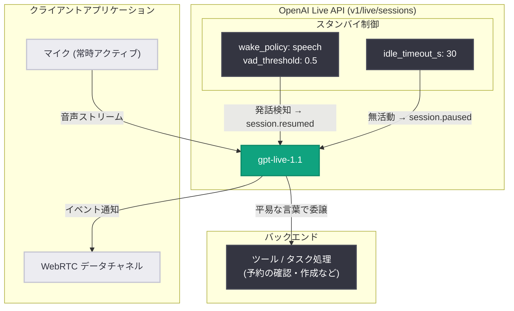
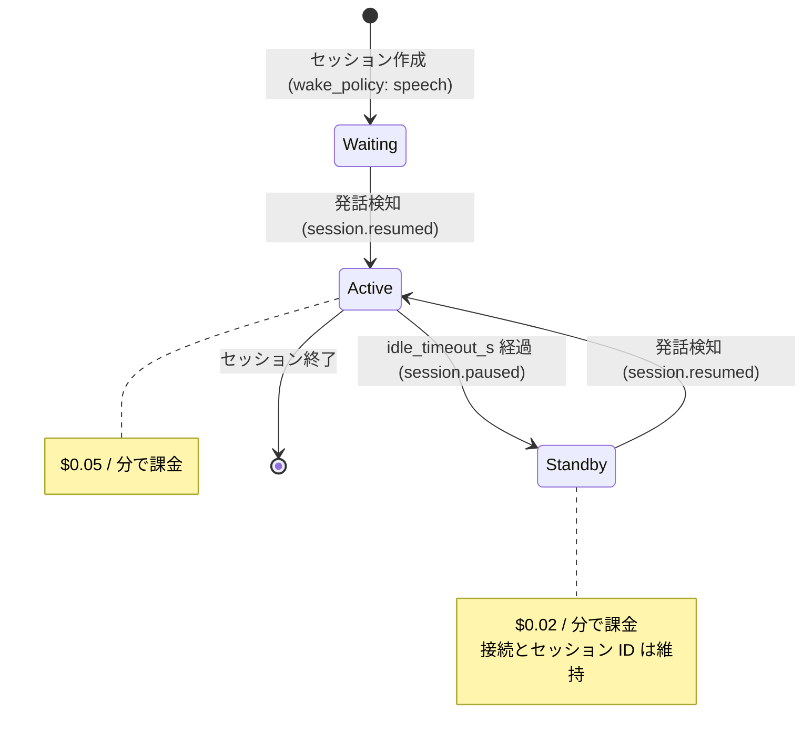

# GPT-Live-1.1 リリースと WebRTC スタンバイ設定の導入

## メタデータ

| 項目 | 内容 |
|------|------|
| 発表日 | 2026-11-19 |
| ソース | API Changelog |
| カテゴリ | 新機能 / API 更新 |
| 公式リンク | https://developers.openai.com/api/docs/changelog |

## 概要

OpenAI は 2026 年 11 月 19 日、Live API (`v1/live/sessions`) 向けの新モデル `gpt-live-1.1` をリリースした。GPT-Live-1.1 は多言語音声会話における発音、アクセントの一貫性、文字起こし精度を改善した全二重 (full-duplex) 音声モデルで、話しながら聞くことができる。既存の Live セッション設定でモデル名を `gpt-live-1.1` に変更するだけで利用でき、バックエンドへのタスク委譲を特殊トークンではなく平易な自然言語で記述できるようになった点が大きな改善である。

あわせて、GPT-Live-1 および GPT-Live-1.1 の WebRTC セッション向けに「スタンバイ設定」が追加された。非アクティブ時に推論を一時停止し、誰かが話すと自動的に再開する仕組みで、スタンバイ中はアクティブ時より低いレートで課金されるため、長時間接続を維持するボイスアプリケーションのコスト削減につながる。

## 主な内容

### 機能 1: GPT-Live-1.1 リリース

GPT-Live-1.1 は多言語音声会話に特化した改善が加えられたモデルである。

**主な改善点**:

- **発音と文字起こしの改善**: 多言語音声会話での発音と文字起こし精度が GPT-Live-1 から向上
- **アクセントの一貫性**: 言語をまたいでもアクセントと声の一貫性を維持
- **平易な言葉での委譲指示**: バックエンドへの委譲タイミングを自然言語で記述可能 (原文: "describe in plain language when to delegate")

**モデル仕様** (モデルページより):

| 項目 | 内容 |
|------|------|
| モダリティ | 入力: 音声、テキスト / 出力: 音声、テキスト |
| 対応エンドポイント | Live (`v1/live/sessions`) のみ |
| サポート機能 | ストリーミング、関数呼び出し |
| スナップショット | `gpt-live-1.1` |
| レート制限 | GPT-Live-1 とは別枠の同時セッション制限 |

委譲指示の書き方は旧モデルから大きく簡素化された。`gpt-live-1` ではプロンプト内で `Generate <|SpawnThinking|>` / `Do not generate <|SpawnThinking|>` といった特殊トークンを使う必要があったが、`gpt-live-1.1` では "Delegate to the backend" / "Do not delegate" のような平易な表現で記述できる。プロンプト構成ガイドでは、`Backchannel policy`、`Interruption policy`、`Delegation policy` の 3 つの見出しを保持したテンプレートから始めることが推奨されている。

### 機能 2: WebRTC スタンバイ設定

GPT-Live-1 および GPT-Live-1.1 の WebRTC セッションで、非アクティブ時に推論を一時停止し、誰かが話すと再開する設定 (原文: "pause inference during inactivity and resume when someone speaks") が利用可能になった。

**設定パラメータ**:

| パラメータ | 内容 |
|-----------|------|
| `session.wake_policy.type` | `speech` に設定すると、発話があるまで推論を開始せず待機 |
| `session.wake_policy.vad_threshold` | `0`〜`1` (デフォルト `0.5`)。高いほど推論開始に強い発話の証拠が必要 |
| `session.idle_timeout_s` | `5`〜`60` の整数。入出力トランスクリプトがこの秒数ない場合にスタンバイへ移行 |

**動作の仕組み**:

- **一時停止**: アイドルタイムアウトに達すると推論が停止しスタンバイに入る。接続とセッション ID は維持される
- **再開**: ユーザーが話すとセッションが再開し、会話履歴が復元される。VAD しきい値は初回ウェイク時と各ポーズ後に適用される
- **イベント通知**: `session.paused` (スタンバイ移行) と `session.resumed` (推論準備完了) をサイドバンドまたは WebRTC データチャネルで監視できる
- `idle_timeout_s` を省略した場合、初回ウェイク後はセッション終了まで推論がアクティブのまま維持される

**注意点**:

- スタンバイ中もマイクのトラックはアクティブに保つ必要がある
- マイクのミュートはセッションをアクティブなままにする (スタンバイとは別の動作)
- スタンバイ後、短い発話への最初の応答は通常より時間がかかる場合がある
- 長い空白期間が想定される場合は、スタンバイではなくセッションを閉じて後で新規作成する選択肢も推奨されている

## 技術的な詳細

### 料金

このエントリ自体に料金の記載はないが、モデルページには GPT-Live-1.1 のセッション時間課金が記載されている (参考: 同 Changelog の 2026-09-10 エントリでは GPT-Live-1 の音声セッションは 1 分あたり $0.05、秒単位課金)。

| 状態 | 料金 |
|------|------|
| アクティブ | $0.05 / 分 |
| スタンバイ | $0.02 / 分 |

スタンバイ料金は推論一時停止中の WebRTC セッションに適用される。バックエンドのモデル・ツール使用は別途課金となる。アイドルタイムアウト値の選択にあたっては、節約できる音声時間と、セッション作成コストや再開までの遅延とのトレードオフを比較することが推奨されている。

### コードサンプル

既存の Live セッション設定でモデル名を `gpt-live-1.1` に変更し、スタンバイ関連のパラメータを追加する例 (ドキュメント記載のパラメータに基づく構成例)。

```bash
curl -X POST https://api.openai.com/v1/live/sessions \
  -H "Authorization: Bearer $OPENAI_API_KEY" \
  -H "Content-Type: application/json" \
  -d '{
    "model": "gpt-live-1.1",
    "instructions": "You are Aki, a calm, friendly voice assistant for a booking service.\n\n## Backchannel policy\nUse brief acknowledgements while listening.\n\n## Interruption policy\nStop speaking immediately when the user starts talking.\n\n## Delegation policy\nDelegate to the backend when the user asks to check availability or create, change, or cancel bookings. Do not delegate for greetings or repeated results. Do not guess the result while waiting.",
    "wake_policy": {
      "type": "speech",
      "vad_threshold": 0.5
    },
    "idle_timeout_s": 30
  }'
```

クライアント側では、スタンバイへの移行と再開をイベントで監視する。

```javascript
// WebRTC データチャネル経由でセッションイベントを監視する例
dataChannel.addEventListener("message", (event) => {
  const msg = JSON.parse(event.data);

  switch (msg.type) {
    case "session.paused":
      // スタンバイに移行 (接続とサイドバンドは開いたまま)
      // マイクのトラックはアクティブに保つ
      showStatus("Standby");
      break;
    case "session.resumed":
      // 推論の準備完了 (初回ウェイクを含む)
      showStatus("Active");
      break;
  }
});
```

## アーキテクチャ

Live API セッションの構成とスタンバイのライフサイクルを示す。





## 開発者への影響

- **移行が容易**: 既存の Live セッション設定でモデル名を `gpt-live-1.1` に指定するだけで、多言語音声品質の改善を利用できる
- **プロンプトの簡素化**: 特殊トークン (`<|SpawnThinking|>`) が不要になり、委譲のタイミングを平易な自然言語で記述できるため、プロンプトの可読性と保守性が向上する
- **コスト最適化**: WebRTC スタンバイにより、長時間接続を維持するボイスアプリ (受付、カスタマーサポート、会議アシスタントなど) のアイドル時間のコストをアクティブ時の 40% ($0.02 / 分) に抑えられる
- **設計上の考慮点**: スタンバイ後の最初の応答は遅延する可能性があるため、`idle_timeout_s` の値はユーザー体験とコスト削減のバランスを見て調整する必要がある
- **レート制限の分離**: GPT-Live-1.1 は GPT-Live-1 とは別枠の同時セッション制限を持つため、段階的な移行や並行運用がしやすい

## 関連リンク

- [OpenAI API Changelog](https://developers.openai.com/api/docs/changelog)
- [GPT-Live-1.1 モデルページ](https://developers.openai.com/api/docs/models/gpt-live-1.1)
- [Live プロンプト構成ガイド (推奨プロンプト構造)](https://developers.openai.com/api/docs/guides/live-prompting#recommended-prompt-structure)
- [Live 会話ガイド (スタンバイ設定)](https://developers.openai.com/api/docs/guides/live-conversations#configure-standby)

## まとめ

GPT-Live-1.1 は、多言語音声会話での発音・アクセントの一貫性・文字起こしを改善し、バックエンドへの委譲を平易な自然言語で記述できるようにした Live API 専用モデルである。同時に導入された WebRTC スタンバイ設定は、`wake_policy` と `idle_timeout_s` の 2 つの設定で非アクティブ時の推論を一時停止し、スタンバイ中はアクティブ時の 40% の料金で接続を維持できる。音声アシスタントを長時間稼働させる開発者にとって、品質とコストの両面で実用的なアップデートとなっている。
