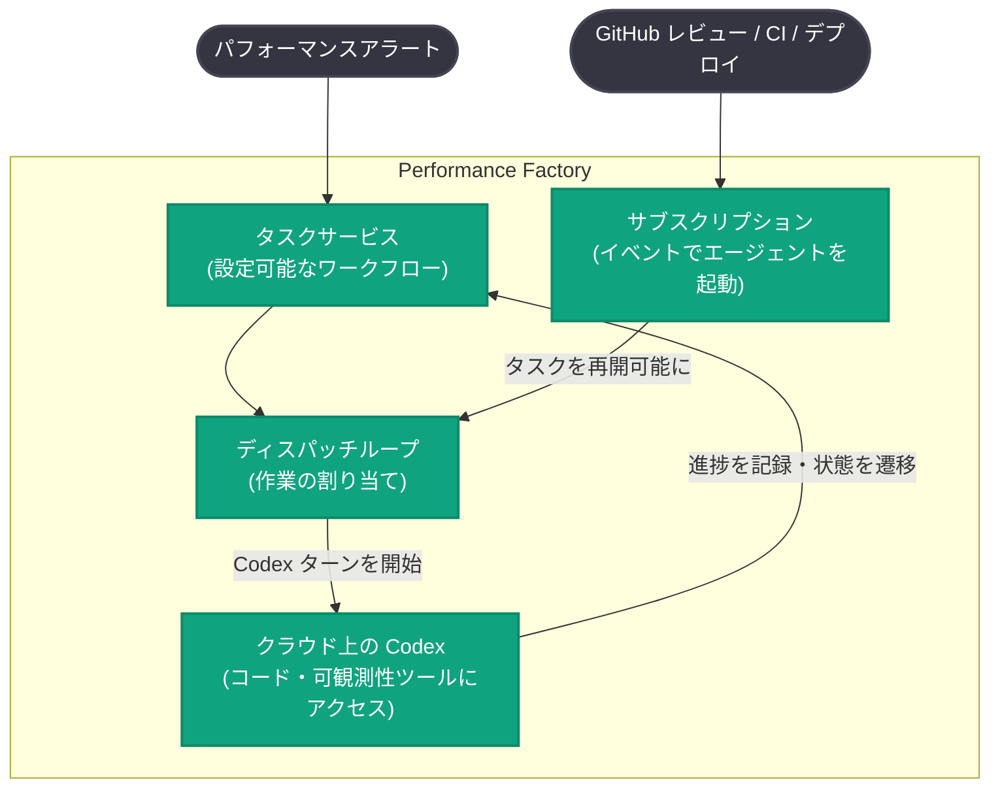
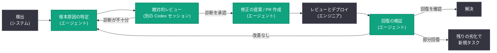

# OpenAI の Performance Factory が ChatGPT を高速に保つ仕組み

## メタデータ

| 項目 | 内容 |
|------|------|
| 発表日 | 2026-11-19 |
| ソース | OpenAI News |
| カテゴリ | Engineering |
| 公式リンク | https://openai.com/index/how-openai-performance-factory-keeps-chatgpt-fast |

## 概要

OpenAI は、Codex を活用してパフォーマンス問題の検出から修正までを自動化する社内システム「Performance Factory」を公開記事で解説した。エージェンティック開発の急速なペースにより、従来の手動によるパフォーマンスエンジニアリングは持続不可能になっており、クラウド上で動作するこのシステムが、リグレッション (性能劣化) の調査・修正・回復検証をエンドツーエンドで自動化している。

最初のワークフローである「Regression Workflow」は、稼働開始から約 3 か月で 1,700 件以上の調査を追跡し、600 件以上の根本原因を特定した。これは 1 日あたり 17 件の自動調査に相当する。手動での根本原因提案 100 件のレビューでは 70% が正確と評価されており、敵対的レビュー (adversarial review) などのチェック機構によって精度向上を図っている。

## 主な内容

### 手動調査から自動ワークフローへの進化

OpenAI のパフォーマンスチームは、Codex の活用が次の 6 段階で進化したと説明している。

1. **Codex 以前**: エンジニアがメトリクスやログを手動で調べ、トレースを比較し、コードを読んで調査。サービスへの深い知識が必要で時間もかかった。頻出する問題 (ChatGPT の初回トークンレイテンシの劣化など) に対して、CPU プロファイラやアロケーションプロファイラなど 30 以上のツールを蓄積
2. **パートナーとしての Codex**: エンジニアが「なぜ遅くなったのか」と尋ね、Codex と協働して調査。巨大なコードベースの検索、関連メトリクスやトレースの発見、サービス間の相互作用の追跡が可能になったが、エンジニアによる誘導は依然必要だった
3. **再利用可能なスキル**: 調査プロセスを `perf-forensics` という共有スキルに体系化。利用可能なツール、使いどころ、調査の進め方を Codex に伝え、アラートを渡すだけで 1 回の実行で診断を得られるようになった。過去のリグレッションに基づく評価 (eval) でスキルをテスト・改良
4. **人間がプロキシ化**: アラートが発火するたびに、エンジニアが Codex にコピー & ペーストし、結果を Slack に貼り戻すだけの存在になっていることに気づいた
5. **自動調査**: アラートが自動的に Codex セッションを起動し、調査結果を Slack スレッドに投稿。ただし修正の作成とデプロイ後の確認は依然エンジニアの仕事だった
6. **ファクトリー化**: エンドツーエンドのエージェンティックワークフローを実行する Performance Factory を構築。各タスクが状態と調査結果を保持し、エージェントとエンジニアの間で作業を引き継ぎながら、コードレビューやデプロイをまたいで再開できる

### Performance Factory の 4 つの構成要素

システムは以下の 4 コンポーネントで構成される。

- **タスクサービス (設定可能なワークフロー)**: エンジニアが Markdown で設定ファイルとプロンプトを記述してワークフローを定義。タスクが遷移できる状態、許可される遷移、エンジニアの介在が必要なステップを設定。全ワークフローは UI で可視化される
- **ディスパッチループ**: 次のステップに進める状態のタスクを定期的にチェックし、現在の状態に対応する指示とともに Codex ターンを開始してエージェントを割り当てる
- **クラウド上の Codex**: 社内ネットワーク内の環境で Codex ターンをプログラム的に起動する内部 API。コードリポジトリと、メトリクス・ログ・トレース・CPU プロファイル・メモリスナップショットなどの可観測性ツールにアクセスできる。エージェントはサービスアイデンティティで実行され、権限のスコープ設定と操作の追跡が可能
- **サブスクリプション**: 人間の対応やデプロイを待つ間、エージェントを起動し続ける必要はない。GitHub のレビューコメントや CI チェックの失敗などのイベントを購読し、イベント発生時にタスクを再開可能な状態に戻す

### 最初のワークフロー: アラートから回復まで

Regression Workflow は、リグレッションの実際のライフサイクル (調査が必要 → 根本原因特定 → 修正提案 → 解決) をそのまま状態遷移としてモデル化している。

- **根本原因の特定**: エージェントはどのメトリクスがいつから悪化し、どのリクエストが影響を受けたかを特定する。アラート発火より前にリグレッションが始まっている可能性を考慮してデータを遡り、「同種のリクエストが実際に遅くなったのか、もともと遅いリクエストの割合が増えたのか」を比較する。その後、デプロイやフィーチャーフラグの変更を調べ、関連コードを読み、ログやトレースで仮説を検証する
- **敵対的レビュー**: 初期には、エージェントが最初に見つけたもっともらしい説明で調査を止めてしまい、誤診となるケースがあった。これを防ぐため、別の Codex セッションが診断の反証を試みる敵対的レビューを追加。前提を再確認し、反事実 (ロールアウトが原因なら、曝露されていない類似リクエストは健全だったか等) をテストする。実例として、画像ダウンロードのエラーを原因と断定した診断に対し、レビュアーが「ファイル配置サービスは既に回復しているのに画像リクエストは失敗し続けている」矛盾を発見し、調査を再開させた
- **修正こそが難所**: 診断が敵対的レビューを通過すると、Codex が修正を実装して Pull Request を作成し、エンジニアがレビューしてマージを判断する。各タスクには、リグレッションの影響・根本原因・修正案の自動生成サマリーがあり、メトリクスの時系列、CPU フレームグラフ、トレースを含めてスキャンしやすく調整されている。デプロイ後はエージェントが起動してベースラインへの回復を検証し、部分回復なら残りの劣化に対して新規タスクを作成、未回復なら調査へ差し戻す

### 得られた教訓

- **エンジニアの注意力を守る**: Codex の生の調査出力は読み解きにくい「テキストの壁」になりがち。ワークフローは関連インシデントをリンクし、チームが重視するメトリクスでグルーピングし、推定インパクトでランク付けすることで、エンジニアが「コンテキストの追加、トレードオフの検討、何を出荷するかの判断」に集中できるようにした
- **エージェントへの変更を評価する**: スキル更新やモデルのアップグレードは、あるケースで改善し別のケースで悪化し得る。調査能力とサマリーの有用性を分けてテストする。調査は過去の本番インシデントに対するバックテストで評価し、答えを示唆する情報を除去した元シグナルから開始する。発生時期・規模・影響リクエストの特定と、証拠に基づく原因のランク付けを別々に採点する。サマリーは保存済みタスクのスナップショットを使い、システムに不慣れなエンジニアでも理解できるかを別のグレーダーが確認する
- **繰り返す失敗を自己修復に変える**: エージェント自体にも監視が必要。壊れたプロファイラや権限不足は最終レポートからは見つけにくいため、毎日エージェントが最近の実行ログからツール障害やアクセスエラーを探す。同じエラーが複数の調査をブロックしている場合、Performance Factory 自身にタスクを作成して修正を提案させる自己修復の仕組みを構築した

## 技術的な詳細

ワークフローの定義は、設定ファイル (TOML) と各ステップ用の Markdown プロンプトから構成される。

### ワークフロー定義の構成例

```text
code-change/
├── config.toml
└── work/
    ├── implementing.md
    └── reviewing.md
```

- `config.toml`: タスクが取り得る状態、許可される状態遷移、エンジニアの介在が必要なステップを定義
- `work/*.md`: 各ステップでエージェントが従うべき指示を記述

タスクは状態と調査結果をエージェントのコンテキスト外に記録するため、別のエージェントやエンジニアがいつでも作業を引き継げる。1 つのワークフローが発見した最適化候補を、別のワークフローのタスクとして起票する連携も可能。

## アーキテクチャ

Performance Factory の 4 つの構成要素と Regression Workflow の流れを示す。



Regression Workflow の状態遷移は次のとおり。



## 開発者への影響

- **エージェンティックワークフロー構築の参考パターン**: 「タスクの明示的な状態管理 + ディスパッチループ + クラウド実行 + イベントサブスクリプション」という構成は、パフォーマンス以外のドメイン (運用、セキュリティ、コスト最適化など) にも適用できる汎用的なエージェントファクトリーパターン
- **敵対的レビューの有効性**: 単一エージェントの結論をそのまま信頼せず、別セッションに反証させる設計は、エージェントの誤診断を防ぐ実践的な手法。大きなジョブを焦点の絞られた複数の Codex ターンに分割するアプローチも精度向上に寄与
- **評価 (eval) の重要性**: スキルやモデルの変更前に、過去インシデントのバックテストとサマリー品質の評価を分離して実施する手法は、エージェントを本番運用するチームに直接役立つ
- **人間の役割の変化**: エンジニアの仕事は手動調査から「コンテキストの追加、トレードオフの判断、出荷の決定」へとシフト。現在のボトルネックは修正のレビューとマージ待ちであり、OpenAI は低リスクな変更を人間の介在なしに出荷することも検討中
- **エージェント自身の監視と自己修復**: エージェントの実行基盤 (ツールや権限) の障害検知と自動修復をワークフロー化する発想は、エージェント運用の信頼性向上に示唆を与える

## 関連リンク

- [How OpenAI's Performance Factory keeps ChatGPT fast (公式記事)](https://openai.com/index/how-openai-performance-factory-keeps-chatgpt-fast)
- [OpenAI Codex](https://openai.com/codex)
- [OpenAI News](https://openai.com/news)

## まとめ

Performance Factory は、Codex を中核に据えてパフォーマンスリグレッションの検出・調査・修正・回復検証をエンドツーエンドで自動化する OpenAI の社内システム。約 3 か月で 1,700 件以上の調査と 600 件以上の根本原因特定 (1 日 17 件) を達成した。タスクサービス、ディスパッチループ、クラウド上の Codex、サブスクリプションの 4 要素からなるアーキテクチャと、敵対的レビューや eval による品質担保の手法は、エージェンティックワークフローを本番運用するあらゆるチームにとって有用な設計パターンである。今後はアラートに依存しないプロアクティブな劣化検出や、低リスク修正の完全自動出荷への拡張が計画されている。
