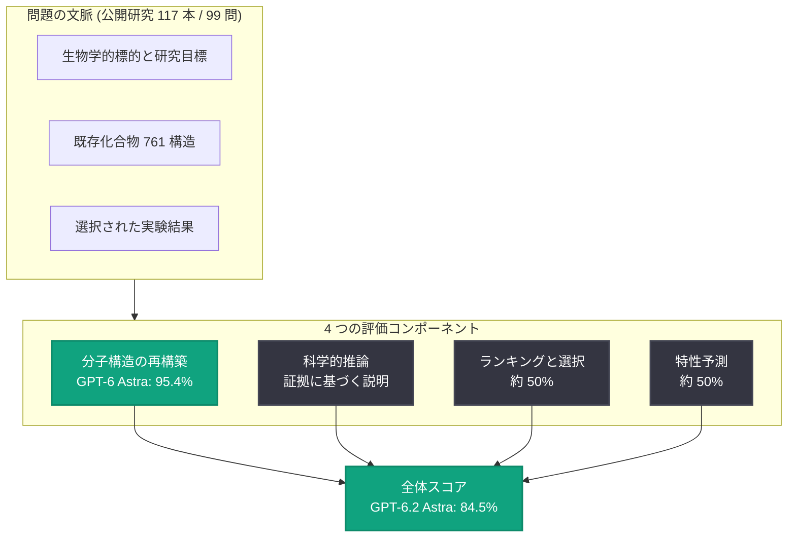

# MedChemBench — 医薬品化学における AI 推論能力のベンチマーク

## メタデータ

| 項目 | 内容 |
|------|------|
| 発表日 | 2026-11-20 |
| ソース | OpenAI Research |
| カテゴリ | 研究成果 |
| 公式リンク | https://openai.com/index/introducing-medchembench/ |

## 概要

OpenAI は、医薬品化学 (メディシナルケミストリー) の実際の研究に基づく推論タスクで AI モデルを評価するベンチマーク「MedChemBench」を発表した。公開された研究 (論文・特許 117 本、761 個の異なる分子構造) から抽出した 99 問で構成され、モデルが分子構造と実験的証拠を結びつけて、結果の説明、化合物の比較、特性の予測を行えるかを測定する。

創薬では「標的タンパク質への強い作用が、必ずしも良好な膜透過性や遅い分解速度を伴うわけではない」というトレードオフが中心的課題であり、AI が科学者を支援するにはこの種の推論能力が不可欠とされる。評価の結果、最新の GPT-6.2 Astra は全体スコア 84.5% (xhigh 設定) を達成し、分子構造の再構築では GPT-6 Astra が 95.4% と高い精度を示した一方、化合物の選択や数値予測は約 50% にとどまり、課題が残ることが示された。

## 主な内容

### ベンチマークの構成

MedChemBench の各問題では、実際の研究プログラムのある時点での情報 (生物学的標的、研究者の目標、これまでに作られた化合物、選択された実験結果) が文脈として与えられ、モデルはそこから推論を行う。

- **問題数**: 99 問
- **出典**: 公開された論文・特許 117 本
- **分子構造**: 761 個の異なる分子構造を含む

### 評価される 4 つのコンポーネント

| コンポーネント | 評価内容 |
|----------------|----------|
| 分子構造 | 原子の結合と立体化学を正しく再構築できるか |
| 科学的推論 | 証拠に基づく説明 (ある化合物を選んだ理由など) ができるか |
| ランキングと選択 | 要件を満たす化合物の順位付け・選択ができるか |
| 特性予測 | 測定値・計算値と一致するか (測定値への近さで部分点あり) |

分子の正確な表現は推論の基盤であり、構造の誤りは分析対象の分子そのものを変えてしまうため、構造再構築は特に重要なコンポーネントと位置づけられている。

### 評価結果

11 個の GPT モデルを複数の推論努力 (reasoning effort) 設定で評価した (GPT-5.6 以降の 9 モデル × 51 の組み合わせを図示)。

**全体スコア (xhigh 設定)**:

| モデル | スコア |
|--------|--------|
| GPT-6.2 Astra | **84.5%** |
| GPT-6 Astra | 83.3% (max effort では 83.8%) |
| GPT-6.1 Sol | 82.0% |
| GPT-6.1 Terra | 75.1% |
| GPT-5.6 Sol | 58.2% |

**コンポーネント別 (GPT-6 Astra、xhigh 設定)**:

- 分子構造の再構築: **95.4%** (最も強い領域)
- 科学的説明: 強み
- 化合物の選択・数値予測: **約 50%** にとどまり、課題が残る

### 具体例

- **PRMT5 阻害剤問題 (がん創薬研究)**: 3 つの化合物について、細胞内での PRMT5 阻害、細胞バリア透過性、肝酵素による分解速度を予測するタスク。実際には化合物 23 が阻害に優れ、化合物 24 が透過性・安定性に優れるというトレードオフが存在した
- **18 原子環の再構築問題**: GPT-6 Astra は 10 回すべて正解。一方 GPT-5.6 Sol は 15 原子環を生成し、GPT-5.6 Luna は分子を 2 つの断片に分断するなど、旧世代モデルは 10 回すべて失敗した

### 制限事項

- モデルが新薬を発見できるか、実験室での意思決定を改善できるかは立証されていない
- 出題元が公開済み文献であるため、学習データへの事前曝露 (データ混入) の可能性を排除できない
- 各回答はツール・フィードバック・新規実験なしの単発試行で評価されている
- 実際の創薬プロセスそのものではなく、「過去の証拠からの推論」を評価するものである

## 開発者・研究者への影響

- **創薬支援 AI の進捗測定基盤**: 分子構造の再構築、科学的推論、化合物選択、特性予測という創薬の中核スキルを定量評価する共通基盤が提供され、ライフサイエンス分野の AI 応用の進捗を客観的に追跡できる
- **モデル選定の指針**: GPT-5.6 世代 (58.2%) から GPT-6.2 Astra (84.5%) への大幅なスコア向上が示され、化学・創薬ドメインのアプリケーションでは最新世代モデルの採用が有効であることが示唆される
- **残された課題の明確化**: 化合物の選択や数値予測が約 50% にとどまることから、現時点では AI の予測を鵜呑みにせず、実験的検証や専門家のレビューと組み合わせる運用が必要である
- **継続的な更新**: OpenAI はモデルの進化に伴う MedChemBench の結果更新を共有するとしており、創薬 AI の能力トレンドを追う指標として活用できる

## 関連リンク

- [Introducing MedChemBench (元記事)](https://openai.com/index/introducing-medchembench/)
- [OpenAI Research](https://openai.com/research)
- [OpenAI News](https://openai.com/news)

## まとめ

MedChemBench は、公開された医薬品化学研究 (117 本、99 問、761 分子構造) に基づき、AI モデルの分子構造再構築・科学的推論・化合物選択・特性予測の能力を測定するベンチマークである。最新の GPT-6.2 Astra は全体 84.5% を達成し、特に分子構造の再構築 (GPT-6 Astra で 95.4%) で高い精度を示した。一方、化合物の選択や数値予測は約 50% にとどまり、実験に基づくトレードオフの定量的な判断には課題が残る。OpenAI は「この作業を確実に支援できる AI の構築は、科学者がより良い医薬品を開発するのを助けるための一歩である」と位置づけ、モデルの進化に伴う結果の更新を予告している。
