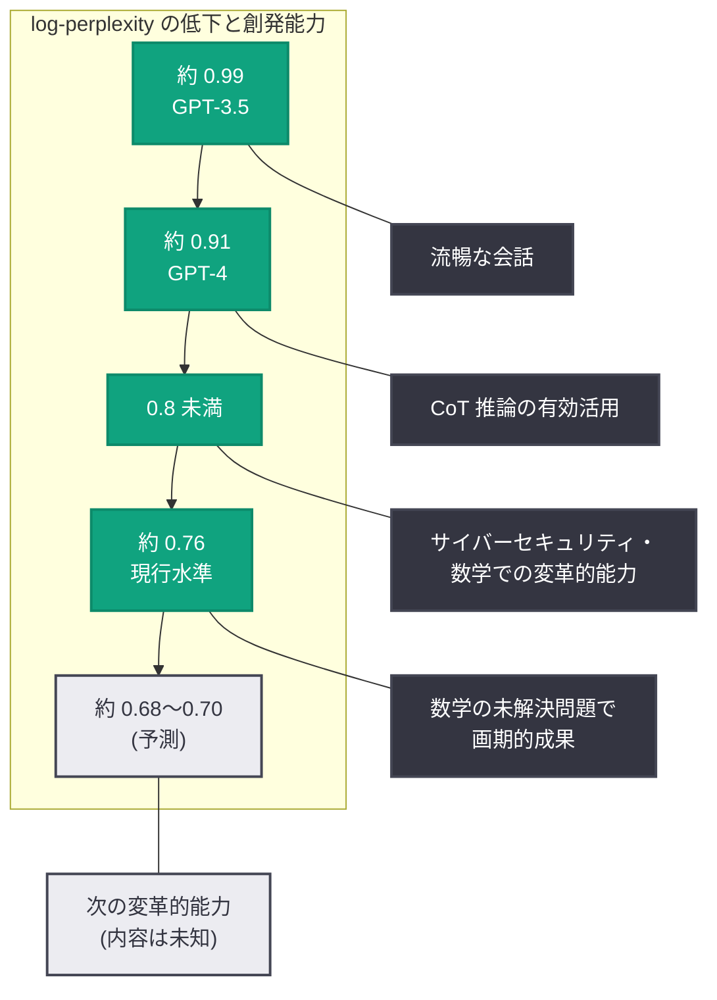

# Perplexity and Intelligence: パープレキシティを AI 業界共通の指標・安全基準にする提案

## メタデータ

| 項目 | 内容 |
|------|------|
| 発表日 | 2026-11-22 |
| ソース | OpenAI News (Research カテゴリ) |
| カテゴリ | 研究成果 / 安全性 |
| 著者 | Jakub Pachocki (OpenAI Chief Scientist) |
| 公式リンク | https://openai.com/index/perplexity-and-intelligence/ |

## 概要

OpenAI のチーフサイエンティストである Jakub Pachocki 氏が、パープレキシティ (perplexity、クロスエントロピー損失) をモデル開発者間の比較と共通の安全基準策定のための指標として確立することを提案するエッセイを公開した。現代の AI は個別技術の寄せ集めではなく、大規模データコーパス上で圧縮器 (compressor、すなわち予測器) を訓練するという単純なプロセスから生まれる知能を活用するものであるという立場から、その進捗を測る時の試練に耐えた指標としてパープレキシティを位置づけている。

注目すべき点として、OpenAI は事前学習 (pretraining) の進捗に関する内部測定値を本記事で公開した。競合他社に手の内を明かす懸念よりも、業界横断の安全対策を確立する緊急性が上回ると判断したためである。

## 主な内容

### パープレキシティと創発能力の対応関係

記事では、OpenAI 内部コードベース由来の評価データセットにおける log-perplexity の値と、各閾値で創発した能力の対応が示されている。

| モデル / 閾値 | log-perplexity | 創発した能力 |
|---------------|----------------|--------------|
| GPT-2 | (旧データセットで SOTA) | 一貫した段落の生成 |
| GPT-3 | 不明 (記事に記載なし) | 文脈内学習 (in-context learning) |
| GPT-3.5 | 約 0.99 | 流暢な会話 (ChatGPT の基盤) |
| GPT-4 | 約 0.91 | 思考連鎖 (chain-of-thought) 推論の有効活用 |
| 0.8 未満 | 0.8 未満 | サイバーセキュリティ・数学での変革的能力 |
| 現行水準 | 約 0.76 | 数学の未解決問題で画期的成果 |
| 予測 | 約 0.68〜0.70 | 次の変革的能力が出現すると予測 (内容は未知) |

著者は、これらの能力が特定のパープレキシティ閾値で出現することは事前には全く予測不能だったと強調し、これを「創発的な潜在能力 (emergent latent capabilities)」と表現している。

### 数学研究での体験

著者は 1 年以上にわたり、数学の未解決問題をモデルに提示して評価を続けてきた。log-perplexity 約 0.76 のモデルに更新した途端、画期的成果が連発し、長年考えてきた問題の解決が「1 つの Slack スレッドで次々と」出てくる様子を "deeply surreal" (深く非現実的) と表現している。

### AI 自己改善への懸念と 2027 年の可能性

- **再帰的自己改善の回避**: 「完全な再帰的自己改善 (full recursive self-improvement)」は、人間の制御維持のため回避すべきとする
- **転換点**: 事前学習のアルゴリズム研究への AI の参加が、特に重要な転換点となる可能性がある
- **雪崩の可能性**: 深層学習研究には「単純な洞察が何年も見逃されてきた歴史」があり、早ければ 2027 年に事前学習の根本的進歩の雪崩 (avalanche) が起こりうる
- **アラインメントの遅れ**: アラインメントや監視の進歩は、この加速に追いつかない可能性が高いと懸念している

なお、2026 年の損失の急激な改善は主に長期的な研究・計算資源投資の成果であり、自動化の寄与は小さいとしつつ、最新モデルでは AI による設計貢献も確認済みと述べている。

### 提案: 共通の開発上限 (common limits)

著者は以下を提案している。

- パープレキシティ等に基づく**共通上限**を設定し、AI の挙動の理解・監視能力が具体的マイルストーン (例: CoT モニターの後継技術の開発) を達成するまで、その上限を越えないことを開発者間で約束する
- フロンティア開発者が共同で評価規範、レッドチーム安全ケース、透明性基準を確立する

## 技術的な詳細

本記事はエッセイ・研究論考であり、API の変更やコードサンプルは含まれない。代わりに、指標としてのパープレキシティが持つ 4 つの課題が整理されている。

1. **ラボ間比較の困難さ**: 評価データセットと訓練データの混合が開発者ごとに異なる
2. **実用的評価との乖離**: パープレキシティ自体は直接のタスク性能に対応しない
3. **事前学習以外の進歩を捕捉できない**: CoT 推論はパープレキシティを下げないが、能力を劇的に向上させる
4. **下限 (floor) が不明**: データの固有エントロピーは未知であり、下限に近づくと見かけの進捗は鈍化するが、小さな改善がより大きな知能向上に対応する

また脚注では、ここでの「圧縮器」は GZIP のような圧縮ファイルを指すのではなく、未知データの予測によって圧縮を行う存在であり、コーパスの内容を必ずしも「記憶」していないと補足されている (Shannon の情報源符号化定理に関連)。

## 開発者・業界への影響

- **透明性の前例**: フロンティアラボが事前学習進捗の内部指標を公開するのは異例であり、他の開発者にも同様の透明性を促す可能性がある
- **安全基準の共通言語**: パープレキシティが共通指標として採用されれば、モデル間比較や規制・ガバナンスの議論に定量的な基盤が生まれる
- **開発上限という新しい枠組み**: 能力の創発が予測不能である以上、特定の閾値を越える前に監視技術のマイルストーン達成を条件とする「共通上限」の考え方は、今後の業界合意形成の軸になりうる
- **評価設計への示唆**: パープレキシティだけでは捕捉できない進歩 (CoT 推論など) があるため、実タスク評価との併用が引き続き必要となる

## 関連リンク

- [Perplexity and Intelligence (公式記事)](https://openai.com/index/perplexity-and-intelligence/)
- [OpenAI Research](https://openai.com/research)
- [OpenAI News](https://openai.com/news)
- 記事内で言及された関連コンテンツ:
  - An alien mind (著者の過去記事)
  - Dario Amodei 氏のブログ "we must pace the frontier"
  - CoT monitorability に関する記事 (alignment.openai.com)
  - Research acceleration: The jagged frontier (2026-11-18)
  - Managing frontier AI risk (2026-11-18)

## まとめ

- OpenAI のチーフサイエンティスト Jakub Pachocki 氏が、パープレキシティ (クロスエントロピー損失) を業界共通の進捗指標・安全基準とすることを提案した
- GPT-3.5 (約 0.99) から現行水準 (約 0.76) までの log-perplexity と創発能力の対応を公開し、約 0.68〜0.70 で次の変革的能力が出現すると予測している (内容は未知)
- 早ければ 2027 年に事前学習の根本的進歩の雪崩が起こりうるとし、監視技術のマイルストーン達成を条件とする共通の開発上限を開発者間で約束することを提案している
- 競合への情報開示リスクよりも、業界横断の安全対策確立の緊急性が上回るという判断に基づく、異例の透明性を持った発表である
