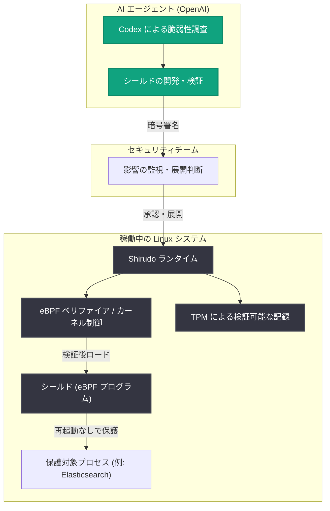

# OpenAI と Cisco が「Shirudo」を発表: パッチ適用前の稼働中 Linux システムを守るオープンソースランタイム

## メタデータ

| 項目 | 内容 |
|------|------|
| 発表日 | 2026-11-23 |
| ソース | OpenAI News/Blog |
| カテゴリ | Security |
| 公式リンク | https://openai.com/index/introducing-shirudo/ |

## 概要

OpenAI と Cisco は 2026 年 11 月 23 日、オープンソースのセキュリティランタイム「Shirudo」を共同発表した。Shirudo (日本語の「盾」に由来) は、パッチの適用や再起動を待たずに、稼働中の Linux システムを保護することを目的としたランタイムである。脆弱性が公開されてからパッチをテスト・展開するまでには数日から数週間かかることがあり、その間のギャップを「シールド」と呼ばれる一時的な保護で埋める。

実証テストでは、Codex が生成したシールドが、稼働中の Elasticsearch サービスに対する Java4Shell 攻撃を再起動なしでブロックした。具体的には、Java の Base64 デコーダに入力チェックを追加するシールドを稼働中のプロセスに直接適用し、悪意ある入力を拒否することに成功している。Shirudo は GitHub で即時利用可能であり、BSD 2-Clause ライセンス (BPF プログラムは BSD/GPL デュアルライセンス) で無料公開されている。

## 主な内容

### Shirudo の 4 つの中核機能

1. **ライブ保護**: 再起動なしで脆弱なコードパスをブロックする。シールドの適用前に影響を監視することも可能
2. **マシンスピードの防御**: AI エージェントが脆弱性を調査し、シールドを開発・検証する。展開の最終判断はセキュリティチームが行う
3. **信頼できる展開**: シールドは暗号署名され、ロード前に検証される。eBPF ベリファイアとカーネルのセキュリティ制御が安全性を担保する
4. **ハードウェアベースの検証**: TPM (Trusted Platform Module) により、保護の適用・削除の検証可能な記録を提供する

### 両社の役割

- **OpenAI**: Codex を含むフロンティア AI と、セキュリティ・インフラ研究を提供
- **Cisco**: インフラとセキュリティの専門知識を提供 (傘下の Isovalent がデモとセルフガイドラボを提供)

OpenAI 社長・共同創業者の Greg Brockman 氏は、多くのチームが同じソフトウェアに依存しているためオープンに構築する意義を強調し、「あるチームがシステムを守るより良い方法を見つけたとき、他のチームはゼロから始める必要がない (when one team finds a better way to protect a system, others don't have to start from scratch)」と述べている。

### 長期的ビジョン

Shirudo プロジェクトは、カーネルやコアサービスの強化、ワークロード権限の最小化、侵害の検出・封じ込め、検証済みの正常状態への復旧など、脅威に適応できるインフラの実現を目指している。将来的には、脆弱性開示と同時にテスト済みシールドを提供することも目標としている。

## 技術的な詳細

Shirudo は Linux の **eBPF** を利用している。eBPF により、Linux カーネル内の特定ポイントで小さなプログラムを実行し、不審な活動の監視と標的を絞った保護が可能になる。

防御の流れは次のとおり。

1. AI エージェント (Codex など) が公開された脆弱性を調査し、シールドを開発・検証する
2. シールドは暗号署名され、ロード前に署名が検証される
3. eBPF ベリファイアとカーネルのセキュリティ制御がシールドの安全性を担保する
4. セキュリティチームが展開を最終判断し、稼働中のプロセスに再起動なしで適用する
5. TPM が保護の適用・削除の検証可能な記録を残す

実証テストの Java4Shell 攻撃ブロックでは、Java の Base64 デコーダに入力チェックを追加するシールドを稼働中の Elasticsearch プロセスに適用し、悪意ある入力を拒否した。詳細は Isovalent のブログで公開されている。

## アーキテクチャ

## 開発者への影響

- **パッチ適用までの空白期間を短縮**: 脆弱性公開からパッチ展開までの間、再起動なしの一時的な保護を適用でき、計画外のダウンタイムを避けられる
- **無料で即時利用可能**: GitHub で公開済みのオープンソース (BSD 2-Clause、BPF プログラムは BSD/GPL デュアルライセンス) であり、開発者・セキュリティ研究者・インフラ運用者がすぐに試せる
- **人間による最終判断を維持**: AI エージェントがシールドを生成・検証するが、展開の判断はセキュリティチームが行うため、既存の運用プロセスに組み込みやすい
- **コミュニティ貢献の機会**: ランタイム本体、新しいシールド、Linux/eBPF への改善など、コミュニティからの貢献が歓迎されている

## 関連リンク

- [公式発表: OpenAI and Cisco introduce Shirudo](https://openai.com/index/introducing-shirudo/)
- [GitHub リポジトリ](https://github.com/shirudo-dev/shirudo)
- [Shirudo ドキュメント](https://docs.shirudo.dev)
- [OpenAI News](https://openai.com/news)

## まとめ

Shirudo は、OpenAI のフロンティア AI (Codex) と Cisco のインフラ・セキュリティ専門知識 (Isovalent を含む) を組み合わせたオープンソースランタイムであり、eBPF を使って稼働中の Linux システムに再起動なしの「シールド」を適用する。シールドは暗号署名と eBPF ベリファイアで検証され、TPM により適用・削除の記録が残るため、信頼性の高い運用が可能である。パッチ適用までの空白期間を埋める新しい防御手段として、2026 年 12 月 15 日の技術ウェビナーなどを通じてコミュニティへの展開が進められる。
