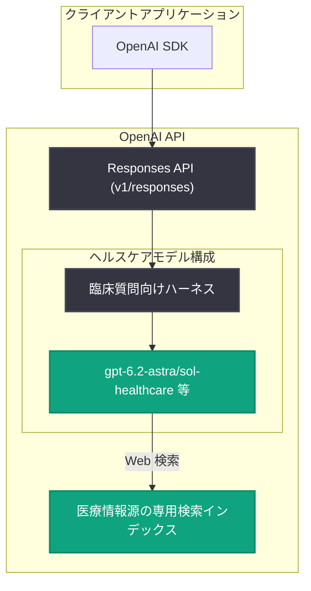

# API Update: chat-latest スナップショット更新とヘルスケアモデル構成の公開

## メタデータ

| 項目 | 内容 |
|------|------|
| 発表日 | 2026-11-24 |
| ソース | OpenAI API Changelog |
| カテゴリ | API 更新 |
| 公式リンク | https://developers.openai.com/api/docs/changelog |

## 概要

2026 年 11 月 24 日、OpenAI API Changelog にて 2 件の更新が発表された。1 件目は `chat-latest` スナップショットの更新で、ChatGPT の Plus / Pro / Business / Enterprise ユーザー向けの最新モデルを参照するスナップショットが新しいバージョンに切り替わった。本番の API 用途には引き続き GPT-6.2 モデルファミリーの利用が推奨されている。

2 件目は Responses API (`v1/responses`) 向けの「ヘルスケアモデル構成 (Healthcare model configurations)」の公開である。選抜された OpenAI モデルに臨床的な質問に特化したハーネスを組み合わせた構成で、Web 検索を使用する際には医療情報源の専用インデックスを検索する点が特徴となっている。

## 主な内容

### chat-latest スナップショットの更新

- **種別**: Update
- **対象モデル**: `chat-latest`

`chat-latest` は ChatGPT (Plus / Pro / Business / Enterprise) で使用されている最新モデルを指すスナップショットであり、今回そのスナップショットが更新された。公式の案内では以下の点が示されている。

- **本番利用**: 本番の API 用途には GPT-6.2 モデルファミリーの利用を推奨 (原文: "We recommend leveraging the GPT-6.2 model family ... for production API usage")
- **chat-latest の位置づけ**: チャット用途の最新改善をいち早く試す目的での使用が想定されている
- **更新頻度**: 基盤となるスナップショットは定期的に更新される

### ヘルスケアモデル構成の公開

- **種別**: Feature
- **対象 API**: `v1/responses` (Responses API)
- **対象モデル構成**:
  - `gpt-6.2-astra-healthcare`
  - `gpt-6.2-sol-healthcare`
  - `gpt-6-astra-healthcare`
  - `gpt-6.1-sol-healthcare`

ヘルスケアモデル構成は、選抜された OpenAI モデルと臨床的な質問向けに特化したハーネスを組み合わせたものである。モデルが Web 検索を使用する場合、一般の Web ではなく医療情報源の専用インデックスを検索する (原文: "it searches a dedicated index of medical sources")。

## 技術的な詳細

今回の変更点を整理すると以下のとおり。

| 変更点 | 内容 |
|--------|------|
| `chat-latest` スナップショット | ChatGPT の最新モデルを参照するスナップショットが更新。定期的に更新されるため、再現性が必要な本番用途には GPT-6.2 系の固定モデルを推奨 |
| ヘルスケアモデル構成 | Responses API で `gpt-6.2-astra-healthcare` などのモデル構成名を指定可能に。臨床質問向けハーネスと医療専門の検索インデックスを使用 |

### コードサンプル

Responses API でヘルスケアモデル構成を指定する例 (モデル名に新しい構成名を指定する)。

```python
from openai import OpenAI

client = OpenAI()

response = client.responses.create(
    model="gpt-6.2-astra-healthcare",
    input="高血圧治療における ACE 阻害薬と ARB の使い分けを教えてください。",
)
print(response.output_text)
```

## アーキテクチャ

ヘルスケアモデル構成のリクエストフローの概要を以下に示す。



## 開発者への影響

- **chat-latest 利用者**: スナップショット更新により応答の挙動が変わる可能性がある。出力の安定性や再現性が求められる本番環境では、GPT-6.2 モデルファミリーの固定モデルへの移行を検討すべき
- **ヘルスケア領域の開発者**: Responses API でモデル名を `gpt-6.2-astra-healthcare` などに変更するだけで、臨床質問向けハーネスと医療専門の検索インデックスを活用できる
- **検索品質の向上**: ヘルスケアモデル構成の Web 検索は医療情報源の専用インデックスを参照するため、一般的な Web 検索に比べて医療分野での情報の信頼性向上が期待できる
- **料金の確認**: ヘルスケアモデル構成は専用の価格体系が公開されているため、導入前に料金ページでの確認が必要

## 関連リンク

- [OpenAI API Changelog](https://developers.openai.com/api/docs/changelog)
- [chat-latest モデル詳細](https://developers.openai.com/api/docs/models/chat-latest)
- [GPT-6.2 モデルファミリー (Latest Model ガイド)](https://developers.openai.com/api/docs/guides/latest-model)
- [ヘルスケアモデル構成の価格](https://developers.openai.com/api/docs/pricing#healthcare-model-configurations)
- [Web 検索ガイド](https://developers.openai.com/api/docs/guides/tools-web-search)

## まとめ

2026 年 11 月 24 日の API 更新では、`chat-latest` スナップショットの更新と、Responses API 向けヘルスケアモデル構成の公開が行われた。前者は ChatGPT の最新改善を API から試せる一方で本番用途には GPT-6.2 系が推奨される。後者は臨床質問向けハーネスと医療専門の検索インデックスを備えた 4 種類のモデル構成 (`gpt-6.2-astra-healthcare`、`gpt-6.2-sol-healthcare`、`gpt-6-astra-healthcare`、`gpt-6.1-sol-healthcare`) を提供し、ヘルスケア領域のアプリケーション開発における信頼性の高い情報取得を後押しする更新となっている。
