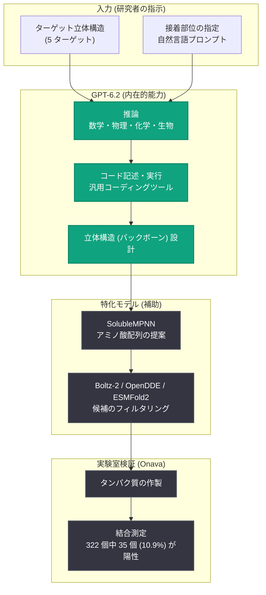

# GPT-6 がタンパク質設計の内在的能力を実証: 推論とコードのみで構造と配列を設計

## メタデータ

| 項目 | 内容 |
|------|------|
| 発表日 | 2026-11-24 |
| ソース | OpenAI News (Publication) |
| カテゴリ | Science (研究成果) |
| 公式リンク | https://openai.com/index/gpt-6-models-demonstrate-intrinsic-protein-design-capabilities/ |

## 概要

OpenAI は 2026 年 11 月 24 日、プレプリント「GPT-6 as a Universal Foundation Model for Protein Biology: Beyond Specialized Models」を公開し、GPT-6 ファミリーのモデルが**内在的能力 (intrinsic capabilities)** としてタンパク質設計を実行できることを示した。これらのモデルは、生物学専用の特化モデルを呼び出すことなく、推論と汎用のコーディングツールだけで新しいタンパク質の立体構造とアミノ酸配列を設計できる。社内研究モデルは多くのタンパク質設計タスクで特化モデルと同等以上の性能を示し、研究者はタンパク質がどこに結合すべきか、どのような形状を取るべきかをプロンプトで指示して設計を誘導できた。

研究パートナーの Onava との実験室試験では、GPT-6.2 の設計に基づくタンパク質が 5 つのターゲットすべてで結合の証拠を示し、再設計された抗体も結合を保持した。ただし候補配列の供給と選別には特化モデルが利用されており、エンドツーエンドでのゼロショット設計が確立されたわけではない。モデルの書き出した推論とコードからは、数学、物理学、化学、生物学の知識を動員してタンパク質の形状や他分子との相互作用を推論している様子が読み取れる。

## 主な内容

### 自然言語による設計指示という新しいパラダイム

タンパク質はアミノ酸の鎖からなり、その配列が立体構造を決め、構造が機能を左右する。科学者は通常「がん細胞が免疫を回避する信号を阻害したい」「大気中の二酸化炭素を回収したい」といった目的から出発し、それを実現する立体構造とアミノ酸配列を逆算する必要がある。

従来の特化モデルはこの作業を実用的にしたが、利用と連携には相当な専門知識を要する。各モデルは特定の入力と制約しか受け付けず、新しい種類の情報を扱うにはソフトウェアの変更や追加学習が必要になる。これに対し、複数の特化モデルの仕事をこなせる汎用モデルは、新しい指示や要件に容易に適応できる。

OpenAI は原子間の 1 つの結合から、タンパク質全体の形状に至るまで、さまざまなスケールでモデルを誘導できたと報告している。たとえば小分子がタンパク質のどこにどう結合するかを GPT-6.2 に予測させる際、すでに判明している 2 原子間の結合情報を与えて残りの分子の収まり方を尋ねることができ、タスクの切り替えは再学習なしでプロンプトの変更だけで済んだ。ミニバインダー (小さな結合タンパク質) の設計では、ターゲットへの接着位置を指定し、さらにコイルやストランドの本数まで指定でき、社内モデルはほぼ完璧な忠実度で立体設計に反映した。

### 計算評価の全体像

OpenAI は GPT-6 シリーズに対し、指定ターゲットに結合する小タンパク質の設計、指定された構造的特徴を軸にしたタンパク質の構築、立体構造と分子間相互作用の予測、配列変化が安定性や結合に与える影響のランク付けについて計算評価を実施した。14 のタンパク質タスクでは世代が進むごとに多くの項目が改善し、最新モデルは大半のタスクで特化モデルと同等か上回った。一方で、**完全なタンパク質立体構造の予測は明確な弱点として残った**。

IL-7Rα に結合する小タンパク質を設計する例では、モデルは 2 つのタンパク質がどのように相互作用しうるかを提案したうえで、コードを記述・実行して相互作用を支えうる形状とアミノ酸の選択肢を探索した。

### 実験室実験 1: ターゲットに結合する小タンパク質の設計

GPT-6.2 に 5 つのターゲットタンパク質の立体構造とミニバインダーの接着希望位置を与え、特化型タンパク質 AI モデルを使わずにコードを書いて候補の立体設計を生成させた。設計を実験可能なタンパク質にするため、配列提案には特化モデル SolubleMPNN を使用し、設計どおりに折りたたまれ意図した部位に結合すると予測される候補の選別にも他の特化モデルを用いた。

計算上の品質指標ではタンパク質設計の特化モデル RFdiffusion と比較し、GPT-6.2 の立体設計はわずかに低いスコア、最新の社内モデルは高いスコアとなった。

実験室では 322 個のミニバインダーを 5 ターゲットに対して試験し、35 個 (10.9%) が意図したターゲットへの結合で陽性となった。

| ターゲット | ヒット数 | 備考 |
|------------|----------|------|
| PD-L1 | 5 | 一部のがんが免疫回避に用いるタンパク質 |
| IL-7Rα | 3 | - |
| TrkA | 1 | - |
| VEGF-A | 8 | - |
| IL-17A | 18 | - |

元の RFdiffusion の研究はこれより高いヒット率を報告しているが、ヒット率は実験検証前のフィルタリングの厳しさや結合の定義に大きく依存するとしている。それでも、GPT-6.2 の立体設計を実際にターゲットへ結合するタンパク質に変換できるという初期の証拠になったと位置づけている。

### 実験室実験 2: 立体構造に対する新規配列の設計

次に、GPT-6.2 自身が配列を設計できるかを検証した。既存のミニバインダーがターゲットに対してどう収まるかの立体モデルを与え、元のアミノ酸配列は隠したうえで新しい配列を提案させた。実験対象の選別には特化モデルを使用している。

3 つのターゲットについて、Onava が先行研究から収集した確認済みミニバインダーの計算予測構造を出発点とした初期スクリーニングの結果は以下のとおり。

| ターゲット | 結合が見られた設計 | 割合 | 元配列との差異 (中央値) |
|------------|--------------------|------|--------------------------|
| MDM2 | 75 / 88 | 85% | 43% |
| VEGF-A | 26 / 42 | 62% | 50% |
| PD-1 | 8 / 59 | 14% | 15% |

さらに、GPT-6.2 が以前生成した未公開のミニバインダー形状 3 件 (PD-L1 向け 2 件、IL-7Rα 向け 1 件) に対して新しい配列を設計させた。これらの形状には特化モデル ProteinMPNN が既に 1 配列ずつ供給しており、その配列から作ったタンパク質は実験室で結合を示していた。GPT-6.2 の新配列から作製した 107 個のタンパク質のうち、14 個 (13.1%) が結合を示した。

同一の PD-L1 ミニバインダー構造に対して、GPT-6.2 は全 90 アミノ酸中それぞれ 52 か所と 58 か所が元と異なる 2 つの配列を設計し、しかも 2 配列間でも 44 か所 (配列のほぼ半分) が相違していた。いずれも同じターゲットへの結合の兆候を示した。未公開構造を用いた点と配列の大幅な相違は、GPT-6.2 の能力が暗記を超えていることの強い証拠であり、構造と配列の双方を内在的に設計できる可能性を示すとしている。

### 抗体の結合部位の再設計

研究者は抗体がターゲットをより強く掴むよう結合ループを再設計することがあり、これを**親和性成熟 (affinity maturation)** と呼ぶ。類似タンパク質に付きにくくする選択性の向上も目的となる。OpenAI はその第一歩として、元のターゲットへの結合を保ったまま新しいループ配列を設計させる試験を行った。

- 同じタンパク質 IL-4Rα に結合する 6 種の小型抗体 (VHH) について、予測立体構造と配列の大部分を与え、ターゲットを掴む 3 つのループを除いた状態で新規配列を設計させた。試験した 182 設計のうち 128 件 (70%) が IL-4Rα への結合の兆候を示した
- 次に既存の治療用抗体に対し、元配列を与えたうえで 3 つの結合ループそれぞれのアミノ酸を約半数置き換え、残りは維持するよう指示した。5 種の治療用抗体に基づく 272 個のフラグメントのうち 179 件 (66%) が元のターゲット (PD-1 または PD-L1) への結合を示した

### その他の設計・予測能力

**プログラマブルな構造設計**: 計算評価において、モデルはターゲット上の要求された位置に接触するミニバインダーを一貫して設計した。構造クラス (全てヘリックス、全てストランド、またはその組み合わせ) の指定や、コイルとストランドの本数の制御もほぼ完璧な忠実度で実現した。結合界面についても、結合時に埋没させるターゲット側アミノ酸や、「β シート - β シート」のような特定の相互作用様式といった詳細な要件を表現できる。OpenAI は、推論能力の向上により、現在の画像生成と同様に望む特徴を記述してタンパク質構造を生成させる世界を想定している。

**モチーフスキャフォールディング**: 酵素設計では、反応が起こる部位で少数の重要なアミノ酸をどう配置すべきかが分かっている一方、それらが鎖上で離れていることがあり、折りたたみによって集合・固定されるよう残りの部分を設計する必要がある。MotifBench の 30 課題 (酵素やタンパク質間結合部位由来の例を含む) でモチーフ (特定の立体配置を持つアミノ酸群) を与え、コーディングツールで周囲を設計させた。各設計について ProteinMPNN が 8 配列を提案し、ESMFold が折りたたみを予測、少なくとも 1 つの予測構造がモチーフを保持しかつ設計全体構造と良く一致した場合を成功とした。予備解析で最新社内モデルは 43.7%、RFdiffusion は 27.8% が両条件を満たした。

**指定フォールドの設計**: 鎖長と CATH (タンパク質構造分類体系) のコードを与え、各アミノ酸の三次元位置を決めさせた。多くの設計は要求された大まかな配置を捉えたが、難しかったのは鎖が正しい経路をたどらせることだった。少なくとも 1 配列が要求フォールドを取ると予測され、かつモデルの立体設計と良く一致した場合を成功とし、200 課題で最新社内モデルは 18.9%、特化モデル Proteina は 17.1% だった。

**ドッキング (小分子とタンパク質の結合予測)**: 実験的に決定された複合体構造から小分子をデジタル的に除去し、タンパク質構造と分子の原子結合を表す SMILES 文字列を与えて、結合位置と向きを予測させた。

| データセット | 条件 | GPT-6.2 | 最新社内モデル | 特化モデル |
|--------------|------|---------|----------------|------------|
| PoseBusters | 結合位置を伝えない | 93% | 96% | DiffDock-L: 50% |
| Scarpino (179 構造) | 結合する 2 原子を伝える | 92% | 97% | DiffDock: 60% |

Scarpino データセットは各タンパク質構造が小分子と化学結合で繋がれたもので、「GPT モデルの大きな利点は、追加情報をプロンプトで直接与えられること」だと記事は述べている。

**抗体 - ターゲットのドッキング予測**: 数百組の抗体とターゲットについて、2 つのタンパク質を別々に提示し表面の原子詳細 (全側鎖) を隠した状態で、結合位置と向きを予測させた。平均 DockQ スコア (高いほど実験観測の配置に近い) は、各モデルの最高評価計算設定において GPT-5.6 の約 0.05 から GPT-6 で 0.28、GPT-6.2 で 0.57、最新社内モデルで 0.81 へと向上した。これらの構造は公開されているため同一または類似のペアを学習時に見ている可能性はあるが、側鎖を全て隠しても世代ごとに精度が向上した点を、より難しいドッキング問題への楽観的な根拠としている。

**変異の影響予測**: コンピュータ上では実験可能な数を大きく超えるタンパク質を設計できるため、どれを先に作るべきかの判断が重要になる。アミノ酸を置換して効果を測定した 4 つの公開データセットを用い、出発タンパク質の配列と 50 個の改変版配列を与え、測定項目だけ伝えて結果は隠し、コーディングツールを使わず推論のみで 50 個を順位付けさせた。安定性研究の 265 セットにおける順位相関 (1 が完全一致、0 が無相関、-1 が完全逆順) は GPT-5.6 で 0.41、GPT-6 で 0.52、GPT-6.2 で 0.57、最新社内モデルで 0.66 と世代ごとに改善した。4 データセットすべてで、GPT-6.2 と最新社内モデルは特化モデル ESM2-650M より平均的に正確な順位付けを行った。

**立体構造予測の初期シグナル**: 既知構造を持つタンパク質のアミノ酸配列を与え、基本的なコーディングツールのみで折りたたみを予測させ、TM-score (1 が完全一致、0.5 超で概ねフォールドを捉えている) で評価した。平均スコアは GPT-5.6 の 0.16 から GPT-6.2 で 0.26、最新社内モデルで 0.38 に上昇したが、特化モデル ESMFold2 の平均 0.93 とは大きな差が残る。構造の大部分が既知で欠損部分を埋める設定では、100 個の抗体フラグメントについてターゲット認識に関わる 6 つのループを隠して予測させ、最新社内モデルはループの形状と位置をかなり正確に予測することが多かったが、配列のみから推論する ESMFold2 の方が全体として依然高精度だった。

## ワークフローの構成

実験室実験 1 における設計から検証までの流れを示す。

## 制限事項

記事では以下の制限が明示されている。

- **特化モデルへの依存**: 今回のタンパク質設計キャンペーンは、候補のフィルタリングに Boltz-2、OpenDDE、ESMFold2 といった特化型構造予測モデルに依存した。GPT モデルが特化モデルと同等の内在的能力を示したのはワークフローのうち 2 段階、すなわちバックボーン生成 (通常は RFdiffusion を使用) と配列再設計 (通常は ProteinMPNN を使用) であり、**特化モデルの助けなしにゼロショットでエンドツーエンドの de novo ミニバインダー生成ができることは、まだ確立されていない**
- **ジャギーな能力フロンティア**: アミノ酸配列から完全なタンパク質立体構造を予測するタスクは、上記の構成要素的タスクよりも依然として格段に難しく、最良の社内モデルでも特化型構造予測モデルに大きく劣る
- **ベンチマーク結果の解釈**: 立体構造からアミノ酸配列を推論させる試験での異常に高い精度は、暗記や構造生成プロセスが残したパターンを部分的に反映している可能性があり、これ単独では未知のタンパク質に対する信頼できる性能を示さない
- **結合は第一歩**: 実験室の結果は設計が機能しうるかの直接的な試験だが、結合は有用な研究ツールや医薬品への一歩に過ぎない。特異性、安定性、生物活性、さらに治療応用に向けた安全性と有効性の確立には追加の作業が必要

## 今後の方向性

OpenAI はこの研究を**プログラマブルな分子設計 (programmable molecular design)** への初期段階と位置づけ、医薬品開発に有用にするため 3 つの領域での進展を目指すとしている。

1. **より難しいターゲットへのミニバインダー探索**: これまでの試みが及ばなかったターゲットに結合する分子の設計
2. **結合後に起こることを見据えた設計**: 設計分子ががん細胞を殺すといった特定の生物学的効果を生み出せるかの検証、意図したターゲットに選択的に結合し製造が実用的な分子の設計
3. **より広範な分子種への拡張**: 今回の実験室実験は小型タンパク質ミニバインダーと抗体フラグメントが中心だったため、複数ターゲットに同時結合する分子、RNA、特定タンパク質の分解を細胞に指示する PROTAC を含む小分子への展開

安全面については、科学の進歩を安全かつ責任をもって加速させる中で、特にバイオセキュリティに関するリスクの評価と低減に取り組むとしている。新薬のためのタンパク質設計を助ける能力は悪用されうるものであり、リスク評価と安全策の試験は Preparedness Framework に基づいて行われる。

## 開発者・研究者への影響

- **専門モデルのオーケストレーション負荷の軽減**: 従来は入力形式や制約が異なる複数の特化モデルを使い分ける必要があり相当な専門知識を要したが、汎用モデルは新しい指示や要件に再学習なしで適応できる。プロンプトの変更だけでタスクを切り替えられる点は、パイプライン構築の負荷を下げうる
- **自然言語による構造制約の指定**: 接着部位、構造クラス (ヘリックス / ストランド / 混合)、コイルやストランドの本数、結合界面で埋没させる残基、β シート間相互作用といった要件を言語で表現でき、ほぼ完璧な忠実度で設計に反映された。OpenAI は画像生成を誘導するように構造生成を誘導できる将来像を提示している
- **既知情報をプロンプトで補える柔軟性**: ドッキングで結合する 2 原子を伝えるなど、研究者が既に持つ知識を直接注入できることが汎用モデルの大きな利点として挙げられている
- **候補選別の優先順位付けへの活用**: 変異の影響予測では推論のみで 50 個の改変版を順位付けし、4 データセットすべてで特化モデル ESM2-650M を平均で上回った。実験に回す候補の選定を支援しうる
- **設計サイクル短縮という位置づけ**: 実験室試験は引き続き設計の重要な一部だが、OpenAI は科学者により多くの制御と柔軟性を与えて 1 ラウンドあたりの時間を短縮し、機能するタンパク質に到達するまでの設計 - 試験サイクルの総数を減らすことを目標としている
- **現時点での適用範囲の見極めが必要**: 完全構造予測には大きな性能差が残り、候補フィルタリングには特化モデルが使われている。どの工程を汎用モデルに置き換えられるかは、制限事項を踏まえた判断が求められる

## 関連リンク

- [GPT-6 models demonstrate intrinsic protein-design capabilities (OpenAI 公式)](https://openai.com/index/gpt-6-models-demonstrate-intrinsic-protein-design-capabilities/)
- [プレプリント: GPT-6 as a Universal Foundation Model for Protein Biology (PDF)](https://cdn.openai.com/pdf/gpt-6-a-universal-foundation-model-for-protein-biology.pdf)
- [OpenAI News](https://openai.com/news)
- [Preparedness Framework (記事内リンク先)](https://openai.com/index/updating-our-preparedness-framework/)
- [Onava (研究パートナー)](http://www.onava.ai)
- [MotifBench](https://arxiv.org/html/2502.12479v2)
- [CATH (タンパク質構造分類)](https://www.cathdb.info/wiki/doku/?id=faq)
- [ESMFold (Hugging Face)](https://huggingface.co/biohub/esmfold_v1)
- [小分子ドッキングの集計データ (OpenAI protein_paper リポジトリ)](https://github.com/openai/protein_paper/blob/4f5fbba67d507f01c5b8f1ea2ba9f5bc8c23494b/figures/section_4/small_molecule_docking/data/success/counts_and_rates.csv)

## まとめ

GPT-6 ファミリーは、生物学の特化モデルを呼び出さず推論とコードのみでタンパク質の立体構造とアミノ酸配列を設計できる内在的能力を持つことが示された。実験室では GPT-6.2 の設計に基づく 322 個のミニバインダーのうち 35 個 (10.9%) が 5 ターゲットすべてにわたって結合を示し、抗体ループの再設計では 182 設計中 128 件 (70%)、治療用抗体フラグメント 272 個中 179 件 (66%) が結合を保持した。ドッキング予測 (PoseBusters で 93%、Scarpino で 92%)、モチーフスキャフォールディング (最新社内モデル 43.7% 対 RFdiffusion 27.8%)、変異影響の順位付けでも特化モデルと同等以上の結果が得られている。一方で完全な構造予測は TM-score 平均 0.38 対 ESMFold2 の 0.93 と大きく劣り、候補フィルタリングは特化モデルに依存しているため、エンドツーエンドのゼロショット設計は未確立である。OpenAI は自然言語で分子の働きを記述して候補を設計するプログラマブルな分子設計を目標に掲げ、同時に Preparedness Framework に基づくバイオセキュリティリスクの評価にも言及している。
