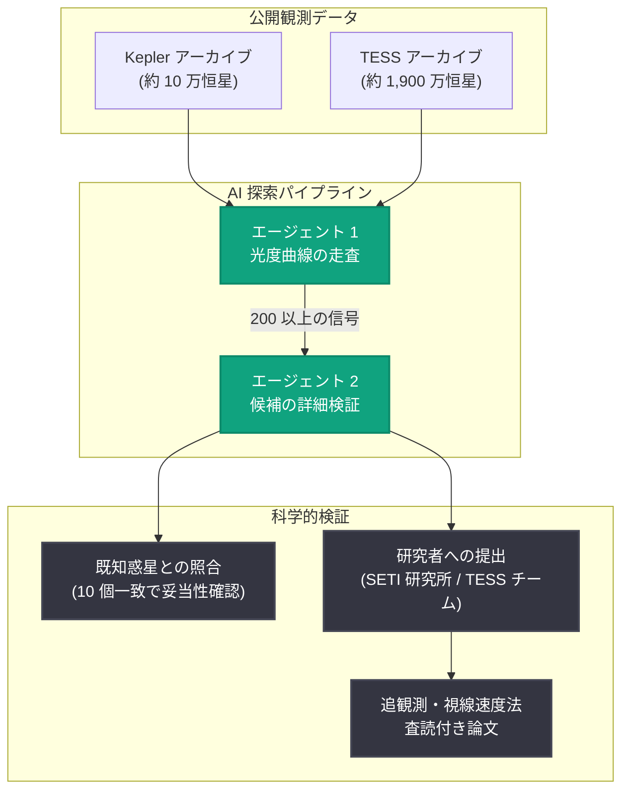

# Astra による系外惑星探索: アマチュア天文家が AI で新候補を発見

## メタデータ

| 項目 | 内容 |
|------|------|
| 発表日 | 2026-11-24 |
| ソース | OpenAI News |
| カテゴリ | Science (研究成果) |
| 公式リンク | https://openai.com/index/searching-for-distant-planets-with-astra/ |

## 概要

OpenAI は 2026 年 11 月 24 日、アマチュア天文家が AI ツール「Astra」や「Codex」を活用して系外惑星の探索を設計・実行し、有望な惑星候補を発見した事例を紹介する記事を公開した。記事では、ケプラー宇宙望遠鏡や TESS が蓄積した膨大な公開観測データを、専門家ではない個人が AI の支援によって解析し、従来の探索では見逃されていた可能性のある信号を検出したことが報告されている。

1992 年の最初の発表以来、確認済みの系外惑星は 6,400 個以上 (NASA Exoplanet Archive、2026 年 11 月 24 日時点) に達している。本記事は、AI を備えた市民科学者が天文学の最前線に貢献できることを示す具体例として、SETI 研究所の天文学者からも肯定的な評価を受けている。

## 主な内容

### 探索手法: トランジット法

惑星が恒星の前を横切る (トランジットする) と、恒星の光がわずかに遮られる。明るさの時系列グラフである光度曲線には、これが周期的な減光として現れる。減光が規則的に繰り返されれば次の観測タイミングを予測でき、統計的検証や視線速度法 (惑星の重力による恒星の揺れを測定する手法) などの追加観測、査読付き論文での公表を経て、惑星として確認される。

### 事例 1: Kevin Bond 氏によるケプラーデータの探索

OpenAI のエンジニアである Kevin Bond 氏は、Codex を使用してケプラー宇宙望遠鏡 (2009-2018 年運用) の約 10 万個の恒星データを探索した。公開済みの手法を比較・統合した探索プログラムを構築し、1 つの AI エージェントが光度曲線を走査し、別のエージェントが候補を詳細検証する二段構成を採用した。

- **検出結果**: 200 以上の信号を検出。うち 10 個は既知の確認済み惑星であり、プログラムの妥当性を裏付けた
- **KIC 5689121**: こと座にある太陽の約半分のサイズの低温星。13.8 日周期の減光を検出し、惑星であれば直径は地球の約 2.4 倍
- **KIC 6691030**: 北天の暗い星。4.8 日周期で、海王星より小さい惑星と整合する信号

SETI 研究所の天文学者が独立した探索で同じ 2 つの信号を発見しており、確認には数か月から数年かかる可能性がある。

### 事例 2: Ethan Byrd 氏による大規模探索

メールインフラ企業 Primitive の創業者である Ethan Byrd 氏は、複数の AI モデルを試した後に Astra を選択し、約 1,900 万個の恒星データを解析した。TESS (2018 年打ち上げ) などの公開アーカイブを使用し、広範な候補探索と、ハビタブルゾーン (液体の水が存在しうる領域) に焦点を当てた探索の 2 つを設計した。

- 初回の探索で 49 候補を検出
- 最有力候補の 1 つを TESS ミッションの研究者に送付済み (解析待ち)
- さらに 2 候補が提出準備中

### 専門家の評価

SETI 研究所の国際 SETI プログラム副ディレクターである Vishal Gajjar 氏は、AI を備えた市民科学者が Kepler Bonus Catalog の探索に貢献できることを示したと評価し、「彼のパイプラインは、従来の探索では見逃されていた可能性のあるデータから有望な候補を浮かび上がらせた」と述べている。初期チェックは有望であり、追観測でさらに判明するとしている。

## 技術的な詳細

記事フッターには「GPT-6 Astra」「GPT-6.2 Astra Sol」などのモデル名が記載されており、Astra はアマチュア天文家が独自の探索を設計・実行するのを支援する OpenAI のツールとして位置づけられている。また、Bond 氏の事例では OpenAI のコーディングツールである Codex が探索パイプラインの構築に使用された。

AI を用いた系外惑星探索には前例があり、2017 年にはケプラーの 15,000 信号で訓練されたニューラルネットワークが Kepler-90 の 8 番目の惑星発見につながっている。今回の事例は、専門の研究機関ではなく個人が AI エージェントを使って同様の成果に迫った点が特徴である。

## アーキテクチャ

Bond 氏が構築した二段構成の探索パイプラインの流れを示す。

## 開発者・研究者への影響

- **市民科学の拡大**: 専門的な天文学の訓練を受けていない個人でも、Astra や Codex を使って公開アーカイブから科学的に意味のある候補を検出できることが実証された
- **探索パイプラインの民主化**: 公開済み手法を比較・統合した探索プログラムを AI エージェントで構築するアプローチは、他の時系列データ解析分野にも応用しうる
- **人間と AI の協働モデル**: AI が候補を抽出し、人間の専門家 (SETI 研究所や TESS チーム) が検証するという役割分担が、科学的な厳密性を保ちながらスループットを高める例となった
- **参加の入口の広がり**: 望遠鏡がなくても、NASA の Exoplanet Watch、AAVSO Exoplanet Observing Program、Unistellar Network (UNITE) などを通じて検証プロセスに参加できる
- OpenAI は天文学に限らず、科学全般でこうした機会を広げたいとしている

## 関連リンク

- [Searching for distant planets with Astra (OpenAI 公式)](https://openai.com/index/searching-for-distant-planets-with-astra/)
- [OpenAI News](https://openai.com/news)
- [NASA Exoplanet Archive](https://exoplanetarchive.ipac.caltech.edu/)
- [NASA Exoplanet Watch](https://science.nasa.gov/citizen-science/exoplanet-watch/)
- [AAVSO Exoplanet Observing Program](https://www.aavso.org/)

## まとめ

本記事は、OpenAI の Astra と Codex を活用した 2 人のアマチュア天文家が、ケプラーと TESS の公開データから複数の系外惑星候補 (KIC 5689121、KIC 6691030 ほか) を発見した事例を紹介した。SETI 研究所の独立探索でも同じ信号が確認されており、専門家による追観測と検証が進行中である。AI エージェントによる探索と人間の専門家による検証を組み合わせることで、市民科学者が天文学の発見プロセスに実質的に貢献できることを示した点で意義深い発表である。
